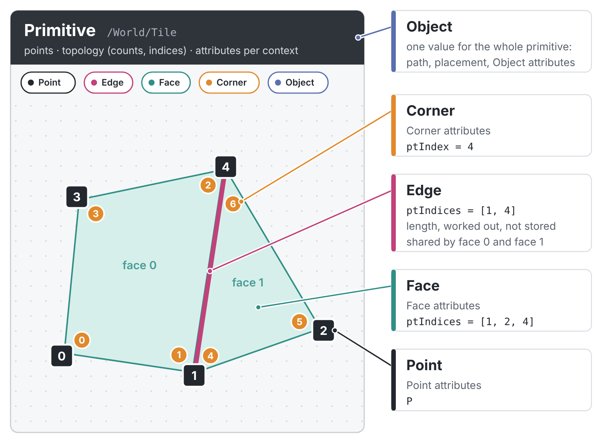

# Imago architecture

The decisions that shape Imago's data and evaluation, and why. Read this before changing the geometry model, a node that touches geometry, the USD path, or ICE. Details live in `docs/geometry.md`, `docs/usd.md` and the code; the operators Imago has and plans are in `XMS_CORE_OPS_SPEC.md`.

## 1. Shape of the program

- **Scene graph:** a node graph, flowing top to bottom. Each node cooks its inputs into an `EvalResult` (a mesh, primitives, an animation clip). The graph is cooked when its content changes, not every frame.
- **ICE graphs:** a graph inside an ICE node, flowing left to right, run on the geometry coming in. Loosely modelled after Softimage ICE and Houdini VOPs.
- **USD is the scene description.** Stages come in through Load USD and go back out through Write USD as opinions over the original file. Imago never needs to own the whole stage.

## 2. USD in

```
file ──openusd (composition)──> xms-usd ──> xms-scene (scene layer) ──usd_stage──> primitives + StageTree
```

- **Composition is `openusd`'s** (pure Rust): sublayers, references, payloads, inherits, specializes, variants.
- **`xms-usd` and `xms-scene`** are forks of rray's `rray-usd` and `rray-scene`. They stay separate crates, ready to merge with rray's into one shared crate when rray becomes a render delegate.
- **openusd's `Stage` is `!Send`.** Translation runs on one thread; only plain data crosses threads.
- **`StageTree`** is the stage's hierarchy, shared by every primitive of the stage. Each node holds its path, type, own transform, and whether it's hidden, an instance proxy or an instancer prototype, and what the file authors on it beyond that (`authored`: `kind`, `instanceable`, `purpose` where authored, single-valued attributes; read by `xms-usd` from openusd's `kind()`, metadata and `authored_property_names()`, arrays and geometry skipped by name). `node(path)` finds a prim through an index. The tree also records the stage's root correction (up axis, unit) and source file. It drives the Scene Explorer, viewport boxes and writing.

## 3. Geometry: `Geo`

One model for primitives, nodes and ICE: its own crate, `crates/xms-geo`, depending on nothing (the app reaches it as `core::geo`, and converts it to and from `MeshData` with `core::geo_mesh::GeoMesh`).

| `Context` | values per | USD interpolation | ICE |
|---|---|---|---|
| `Object` | prim | `constant` | per object |
| `Point` | point | `vertex` | per point |
| `Face` | polygon / curve | `uniform` | per face |
| `Corner` | polygon corner | `faceVarying` | per sample |



Edges are not a context: they are worked out from the topology (each pair of points that follow each other around a face, or along a curve), so they carry no attributes of their own. The Primitive Inspector lists them, with their `ptIndices` and length.

- **`Column`:** a typed array, `Arc<Vec<T>>` for `T` in `bool, i32, f32, [f32;2], [f32;3], [f32;4], quat, [f64;16], token`. This is the generalised `Array<T>`: every attribute in every context is one.
- **`Attr`:** a column, plus optional indices (USD indexed primvars) and a role (point, normal, vector, colour, texCoord) for writing the right USD type.
- **`Topology`:** `Points`, `Mesh` (counts, indices, orientation, subdivision scheme) or `Curves` (counts, basis, wrap). The arrays are `Arc` too.
- **Names follow USD:** `points`, `normals`, `st`, `widths`, `displayColor`, a primvar's own name. Interfaces may alias them (ICE's `P`).
- **`validate()`:** attributes cover their context, indices are in range, topology references existing points.

## 4. Copy on demand

- **Cloning a `Geo` copies pointers.**
- **Writing goes through `Arc::make_mut`:** only the written column is copied, and only if shared.
- **Consequences:**
  - A node changing UVs on a 10M-point mesh copies one column.
  - Untouched data (normals, primvars, subsets, UV indices) survives every node.
  - **Identity is information:** a column still pointing at the loaded `Arc` is, by that fact, unedited.

## 5. Primitives

`Prim`: one per mesh, curves or points prim, passed between nodes without copying.

| Field | |
|---|---|
| `path` | prim path (instance proxies under their instance's path) |
| `geo` | geometry in its **own space** |
| `place` | `InPlace`, `One(Mat4)`, or `Many(Arc<[Mat4]>)` for point-instancer copies. Stage prims are always placed: world transform × root correction |
| `source` | the prim as loaded (geo, place, material, purpose): what edits are measured against |
| `stage` | `Arc<StageTree>` |
| `material`, `look`, `purpose`, `picked` | |
| `camera` | a camera (`core::camera::Camera`, USD's values): the prim is one, with no geometry, placed. A file's carry the shared empty geometry (`nodes::no_geometry`) as geo and source, so only a move is an edit |
| `shading` | a material Material Binding put in the scene: the prim is it, with no geometry. Not drawn, listed as `Material`, written as `def Material` (`usd_write::new_prim`) |
| `render` | a render prim (`core::render::RenderPrim`): RenderSettings, RenderProduct or RenderVar, with no geometry; its attributes as `.usda` writes them (`RAttr`) and its relationships (`RRel`, appended on an `over`). Not drawn, listed by its type, written by `usd_write::new_prim` |
| `mesh` | `MeshData` view of `geo` for legacy consumers (viewport, Edit Poly, UV). Temporary, see §9. A stage's primitives and ICE's results get the lean view (`to_mesh_lean`: no `primvars`); their attributes stay in `geo`, and the Primitive Inspector makes their rows from it when a geometry tab is opened |

- **Cameras:** the Viewer gathers the scene's cameras when it builds its scene (`viewer::scene::Scene::cameras`), draws each as a pyramid (`Camera::glyph`) and, when one is chosen (`viewer::camera::look_through`, a path), draws through it (`Camera::view_proj`: reversed depth as the Viewer's own camera, the gate fitted in the view). Navigating or framing hands the view back to the Viewer's own camera at that place (`Viewer::leave_camera`).
- **Render prims** (`core::render`): RenderScene Settings, Render Settings and Render Variables each take the scene and put back their render prims (`render::put`: in place of the prim at that path, else last). Render Settings and Render Variables find the RenderSettings prim without a wire (`render::find_settings`: the `primary` one RenderScene Settings made, else the first made, else the first of a stage's `StageTree` by type, written as an `over`, else made). Renderer definitions are JSON (`render::Definition`), Karma's and Arnold's embedded with `include_str!` from `assets/renderers`, others read once from the renderers folder (`render::definitions`). The Parameters pane reads the scene coming in through `NodeGraphState::eval_render_context` (cameras, products, the settings found), kept until the graph changes; its panels are `properties::render`.
- **Load modes:** Load USD builds its primitives with `nodes::stage_prims`. Sublayered, they keep the file's paths and share the cached stage's tree. Referenced or payloaded, `usd_scene::referenced_prim` picks the prim (named, else `defaultPrim`, else the first root prim), and `StageArc::place` rebases every path to the Primitive Location: the primitives, their bindings and prototypes, and the tree (`usd_scene::rebased`, with Xforms above the location and `StageTree::arc` set). Write USD sublayers the trees without an arc and writes the others as a `references` or `payload` on their location (`usd_write::arc_prim`).
- **Instancing is kept.** Prototype geometry is held once, and copies are placements. Transform moves placements, not points.
- **A point instancer is a primitive:** `Topology::Points`, one point per instance, its arrays as Point attributes (`points`, `orient`, `scale`, `protoIndex`, `id`), with `Prim::instancing` holding its prototypes' paths by index. It is not drawn nor merged into a mesh (`merge_world`). Its prototype meshes carry their placements (`Placement::Many`) for drawing, made from its points (`Prim::instanced_by`, `core::instancing::sync`, run after every operator): only when the instancer's points or placement are no longer those they were made from. A prototype's placement is therefore not an edit of its own (`edits::prim_edit`); the instancer's are, written as its arrays (`usd_write::instancer_array`).
- **Nested instancers:** an instancer in another's prototype is found by `usd_stage::Walk::gather` and read by `instancer_at` at every copy of that prototype (`UsdInstancer::by`): its prim is placed `Many` and `instanced_by` the outer one, its prototypes' meshes at its points in every copy. `instancing::copies` places at each copy of an instancer, and `sync` runs a pass per level, so a change to the outer instancer reaches the inner one's meshes.
- **The Primitive Inspector lists instanced geometry once** (`prim_inspector::instanced`): a point instancer as its points, prototypes and native instances' meshes in their own space, each once, with their copies counted in the Properties tab.
- **Nothing is baked.** Up axis and unit live in the placement, never in the points.
- **Primitive Locations:** an operator that takes them (`core::locations::takes_locations`: Transform, Edit Poly, Prune) holds a list on its `GraphNode` (`locations`), saved with it and part of its cook key. When the list says something, `cook` picks what it matches (`locations::target`), runs the operator, and puts the incoming picks back (`restore_picks`), so the list never reaches the operators after it. Prune prunes by the list. An empty list leaves the operator as it was.
- **Pick, then edit:** nodes work on picked primitives and pass the rest through. A single placed prim is edited where it's drawn and returned to its own space and placement (`map_mesh`). Several picked prims are merged (`geo: None`). With no pick, a lone primitive is edited the same way, so a shape stays a primitive through Edit Poly and the UV nodes.
- **Materials are values:** the Material operator gives `EvalResult::Material(Arc<core::material::Material>)`: a `PreviewSurface` (UsdPreviewSurface inputs and texture files, the node's saved parameters), its prim name, and its `Look` for the Viewer. `NodeGraphState::cook` names it by the operator (`material::prim_name`), and the node's name is part of its cook key. Viewed on its own it is drawn on a sphere (`material::preview`); `material::network` gives it as USD has it (a `Material` and its shaders).
- **Material Binding:** cooked by input number in `NodeGraphState::cook` (input 0 the scene, then one material each) into `material::bind`: each material a prim at its Material Library Location (`Prim::shading`), each Bindings row's material (`BindTo`: the same-numbered input, another, or Location, a scene path) set as `material` and `look` on what the row takes, the later row winning. Its material inputs are on the node's left and a Material's output on its right (`node_graph::ui::side_input`, `side_output`, `node_height`), purple; `keep_an_input_free` adds one when the last is wired.
- **Shapes are primitives:** Cube, Sphere and Grid give `EvalResult::Named` with one `Prim` at their Primitive Location (`types::prim_location` makes the typed text a valid USD path). `EvalResult::Single` is left for the plain meshes of Unpack, a flattening Merge and ICE on a plain mesh.
- **Set Attribute** (`core::set_attribute`, its values and their inheritance in `core::properties`): rows of one value each, set on the prims its locations **name** (`locations::names`: that prim alone, of any type, not what is below it). On a primitive, an Object value is an Object attribute of its `Geo`, `purpose` is its `purpose`, `active` off drops it, and other Property values go in `Prim::props`. On a stage prim without geometry (group, camera, light) the values are opinions in a new copy of its `StageTree` (`opinions`), shared by every primitive of the stage; `active` off there drops what is below it, `visibility` invisible hides it in the Viewer (`properties::invisible`). On an Xform Imago made above its own primitives (no stage has it), the values are carried by each primitive below (`Prim::above`) and written once on the Xform. What is set on a prim is inherited below it as USD does (`properties::above`, `invisible`, `purpose_of`, `inherited_primvars`; `purpose_from` weighs a purpose authored in the file against one set by Set Attribute, the nearest prim winning): the Viewer and the Primitive Inspector go by it; ICE reads only a primitive's own attributes. The Primitive Inspector's Properties tab (`prim_inspector::scene_properties`) lists the selected prims themselves, each value with where it comes from; the Set Attribute that set one is found by walking up the graph from the view flag (`set_by`), as are the Load USD that read a stage (`load_of`, by the stage's layer) and the shape that made a primitive (`shape_of`): each row keeps that operator, which its "Go to Operator" selects.
- **Merge by data type:** `MergeMode::Auto` merges primitives when the first input is primitives (`nodes::merge_prims`), else flattens; Primitives and Flatten force it. Any number of inputs (`NodeType::Merge::inputs`, one kept free by `keep_an_input_free`, as on Material Binding); on the same path the later input is the stronger, its unset material, stage, source and purpose read from the first, like an `over`.

## 6. Edits and USD out

- **`edits::prim_edit`:** a primitive compared with its `source`, **by pointer**. The result covers placement, topology, attributes written or added, attributes lost, material and purpose. If `replaced` is set, the geometry is no longer traceable and must be written whole.
- **`edit_set(prims, tree)`:** a stage's changes, prims no longer arriving (to deactivate), and prims made by nodes (to add).
- **`edits_between(a, b)`:** the edit layer of the nodes between two points. This is the basis for Solaris-style stacked layers.
- **Write USD (`usd_write`):** an `.usda` that sublayers the source and holds only `over`s.
  - It repeats `upAxis` and `metersPerUnit`, since USD reads stage metadata only from the root layer.
  - Moved prims get their own `xformOp:transform` (`L' = L · loaded⁻¹ · now`), so they keep following their parents.
  - Changed attributes are written with type, interpolation and indices; lost ones are blocked with `= None`.
  - Pruned prims are deactivated; new prims are written as `def`s, their parents as `def Xform` unless a stage has them, in the first stage's axes and unit (Y up, metres without one). `defaultPrim` is the first stage's first root, or the first prim made in Imago.
  - **Not written yet, but reported:** edits inside native instances (instance proxies are read-only in USD) and on point-instancer prototypes.
  - Set Attribute's values: `Prim::props` and `StageTree::opinions` are empty as loaded, so all they hold is written, as attributes or metadata by name (`props::written`), Object values on prims without geometry as constant primvars.
  - Values are written at the current frame.

## 7. Viewer

- **One scene, at the view flag.** `NodeGraphState::evaluate_scene` gives the scene at the view flag: the viewed output (`view_output`) of the viewed operator. There is no Output node; one operator always has the flag (`set_view_flag`, `repair_view_flag`). The Viewer draws it, `SceneHierarchy::rebuild_scene` lists it as its own tree (no row per operator, each row with its `path`), and the Primitive Inspector shows the selected row's part of it (`prim_inspector::scene_parts`).
- **Draws what the Scene Explorer opens.** A closed prim is the box around its subtree; open prims hand down to their children. There's a per-row geometry toggle and a "Show all geometry" switch. Boxes come from the primitives as they arrive, so they follow upstream nodes.
- **Purposes:** guide/proxy/render toggles. Render geometry gives way to its asset's proxy when proxies are shown.
- **Instancing:** a mesh with more than 64 copies is one entity with a GPU instance buffer of matrices and colours, uploaded once per change. Fewer copies are drawn as entities with full materials.
- **Curves and points:** curves are evaluated to polylines at draw time (their control points are kept); points are drawn as crosses sized by width.
- **Redraws on demand:** input, a change, playback, background jobs. An idle window costs nothing.
- **Renderer:** wgpu 30 (egui and eframe 0.36, egui_dock 0.21), drawn by `src/viewer/` inside the eframe window: the Viewer's picture is made in a texture of its own (reversed infinite depth, 4x multisampling, linear light) and laid into its pane by egui's paint callback. Polygon edges, materials and textures are drawn per copy by instancing. The interface and the per-frame state work are plain functions (`draw_ui`, `history_frame`, `track_revision_frame`, `save_first_frame`, `refresh_*`) the eframe app calls each frame.

## 8. ICE

**Now:** a graph runs on each primitive, in the primitive's own space (object space), on its `Geo`, through the engine (`crates/xms-ice`): the editor's graph (`src/ice`) is turned into the engine's, compiled against the primitive's attributes and run. It ends in an ICE Execution Ports node whose Execute ports (Set Data nodes) run in order over a context; Get Data reads attributes (`P` = points). Only the set attributes get new columns. The output is the primitive with its `geo` updated, so ICE results are edits like any other node's and are written to USD the same way. A graph that does not compile leaves the primitive as it came, and shows why on the node. What the topology gives (a face's corners, first corner, normal, area; a corner's point, face, place) is read under the Primitive Inspector's names (`xms_ice::derived`), made only when a plan reads it. Set Data writes into its own context or carries the column into another after the run (`exec::carry`, the same maps as Get Data, the other way). Only nodes reaching the ICE Execution Ports count towards the cook; the editor keeps the last input geometry (columns shared) to colour ports and list attributes.

**The engine (its own crate, `crates/xms-ice`, on `xms-geo` only; being built on `core/ice-refactor`):** stage 1 is in: the graph (`Op`: Get Data, Set Data, Parameter, Constant, Math), the compiler (types, contexts, uniform hoisting, only what reaches the root, reads and writes listed) and the batched executor (4,096 elements a batch, Rayon, registers per thread). It reads only the columns the graph uses and gives new columns only to the attributes it sets; every other column of the result is the input's. The ICE operator moves onto it in stage 2.

**Planned engine:** loosely modelled after Softimage ICE and Houdini VOPs: ICE's contexts and per-element arrays, with a compile step in the spirit of VOPs. Three layers.

1. **Graph.** Ports carry **type**, **structure** (single value, or array per element) and **context**. These are validated when you connect, and a mismatch shows as a red wire. Constants take the context they're wired into. The graph runs over a chosen context and executes its Execute ports in order.
2. **Compiler.** It turns the graph into a plan:
   - context and type resolution
   - **uniform/varying analysis**: object-context values, constants and parameters are computed once and hoisted
   - dead-code elimination and constant folding
   - compounds inlined
   - polymorphic nodes monomorphised into typed instructions
   - **read/write analysis**: only written columns are copied
   - parameter changes update a constant table and never recompile
3. **Executor.** It runs the plan:
   - **batches** of about 4–16k elements through the whole plan, with per-thread batch registers and no full-size temporaries
   - Rayon over batches; tight per-instruction loops that auto-vectorise
   - group masks: only selected elements are iterated
   - an element writes only itself; writes elsewhere go through explicit **merge modes** (set, add, min, max, append), resolved deterministically after each batch
   - spatial indices built once per evaluation and shared
- **Snippet node** (wrangle-like inline code): compiles to the **same instructions** as nodes, so it's just as fast and uses the same plan.
- **Promoted parameters,** value watches on wires, per-node timings.
- **Simulation** (state across frames) comes later, as a separate mode.
- **Keep the instruction set pointer-free** (typed column loads and stores, maths) so the plan can later be lowered to WGSL and run on the GPU.

## 9. Rules for anyone writing a node

1. **Replace only the columns you change.** Clone the `Geo`; write through `points_mut()`, `attr_mut()` or `set()`. Never rebuild a `Geo` to change one thing: every rebuilt column becomes an edit, a copy and a write.
2. **Keep primitives placed.** Move by `place` (`Placement::moved`), and work in the primitive's own space. `Prim::world()` gives the drawn mesh when needed.
3. **Keep identity.** Build outputs with `Prim { geo, mesh, ..p.clone() }` so `path`, `source`, `stage`, material and purpose travel along. If geometry can't stay traceable, set `geo: None`.
4. **Keep `mesh` in step with `geo`.** Rebuild the view (`geo.to_mesh()`, or `to_mesh_lean()` when `geo` is kept with it), or clear `geo` if only `mesh` changed.

## 10. Where it's going

1. **Done:** eframe + wgpu replaced Bevy as the shell (branch `core/uiframework`). Next for the Viewer: draw straight from `Geo`, retiring the eager `MeshData` view; modes (Scene, Render, Image).
2. **The ICE engine** of §8.
3. **rray as render delegates**: its viewport integrator and path tracer, consuming the scene layer plus edits (dirty bits). At that point `xms-scene` and `rray-scene` merge into one shared crate.
4. **Follow-ups:**
   - Write USD: time samples over a range, prototype/de-instance choice, flatten
   - instancer edits
   - LOD and culling for heavy instancers
   - implicit shapes, per-face material subsets

## Module map

| | |
|---|---|
| `src/app.rs` | `AppState`: the program's whole state (graph, ICE graphs, panes, files, undo), owned by the shell |
| `src/eframe_app.rs` | the shell: the eframe window owning `AppState`, calling the interface and the frame's state work |
| `src/viewer/` | the Viewer's 3D view on wgpu (eframe shell): camera and navigation, the scene from the graph's output (materials and textures, skeletons), Edit Poly's picking and manipulators (`edit.rs`), the GPU picture laid into the pane |
| `src/core/xform.rs` | `Transform` (translation, rotation, scale) for clips, on glam |
| `crates/xms-scene`, `crates/xms-usd` | scene layer, USD → scene layer translation (forked from rray) |
| `crates/xms-matx` | MaterialX: its node libraries (vendored, MaterialX 1.39) read into typed node definitions (`Library`, `NodeDef`, `Input`), and which definition a node is from the types connected to it (`Library::resolve`); a graph of them (`Graph`: connecting picks the definitions, up the graph where it must); the graph as a `.mtlx` document and back (`document`), the materials of any `.mtlx` file, node graphs laid out flat (`import`, tested on every MaterialX example in `tests/examples`), as a USD network and a USD material's network read back (`usd`, the UsdPreviewSurface family as USD has it), and what the Viewer shows of it (`preview`); a small XML reader. Dependency-free |
| `src/materialx/` | The MaterialX operator: its graph in the operator (`NodeType::MaterialX`, saved as its document), the canvas it is edited in (`ui`, as the ICE graph's), the Parameters of its nodes laid out from their definitions (`params`), its material's surface for the Viewer (`surface_of`), a stage's material as a graph (`from_usd`, from the scene layer's shader network) |
| `src/usd_stage.rs` | scene layer → `Geo` + placements + `StageTree` |
| `src/usd_scene.rs` | `UsdScene`, loading and caching, root-layer fallback |
| `crates/xms-geo` | `Geo`, `Column`, `Attr`, `Topology`, `Context`, `CurveBasis`, `CurveWrap` (in the app: `core::geo`) |
| `src/core/geo_mesh.rs` | `GeoMesh`: `Geo` to and from `MeshData` |
| `src/type_colours.rs` | `DataType` and its colour: the colour of a type on ports and wires in every graph (ICE, MaterialX, material sockets) |
| `src/core/sequences.rs` | File sequences and UDIM tiles: the files a `<UDIM>` path stands for, a folder's files with sequences as one entry (the file browser); the Viewer's textures lay UDIM tiles out in one image (`viewport::textures`) and scale each material's UVs to it (`viewer::gpu::map_place`) |
| `src/graph_ports.rs` | What every graph does the same way with ports, wires and selection: a port picked to unplug (`Picked`), the marquee and the picked-port ring |
| `crates/xms-ice` | the ICE engine: graph, compiler, batched executor |
| `src/core/properties.rs` | Properties: values and their types, Object and Property contexts, the properties Imago knows and how each is written, opinions on prims without geometry, inheritance (visibility, purpose, Object values) |
| `src/core/render.rs`, `assets/renderers/` | Rendering as UsdRender has it: render prims (`RenderPrim`), the RenderScene Settings, Render Settings and Render Variables operators' work, finding the RenderSettings prim, renderer definitions (Karma, Arnold as JSON; more from the renderers folder). Their panels: `src/properties/render.rs` |
| `src/core/set_attribute.rs` | The Set Attribute operator: its rows, and setting them on the prims its Prims Location tab names |
| `src/core/locations.rs` | Primitive Locations: matching paths, picking by a list, pruning |
| `src/types.rs` | `Prim`, `Placement`, `Source`, `Purpose`, `EvalResult`, `map_mesh` |
| `src/edits.rs` | edits against the source, edit sets, layers between nodes |
| `src/usd_write.rs` | override layer writer |
| `src/node_graph/` | scene graph: nodes, evaluation, UI |
| `src/scene_explorer/` | the Scene Explorer: the scene at the view flag as a tree |
| `src/ice/` | ICE graphs: graph, execution, editor |
| `src/viewport/` | the Viewer's 3D view: bounds and boxes, GPU instancing, camera |
| `src/strands.rs` | curves and points as lines |
