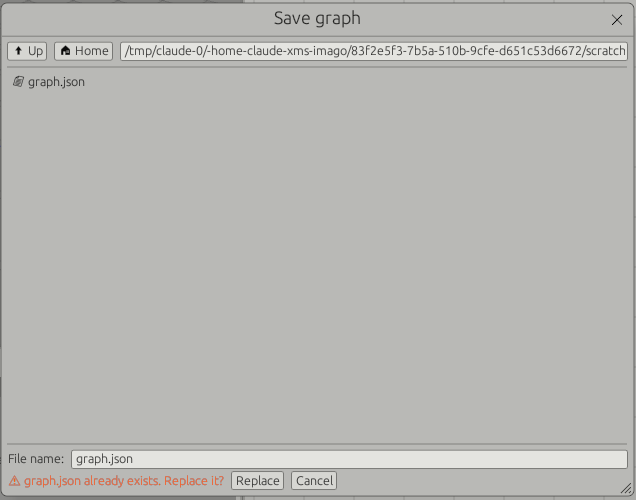
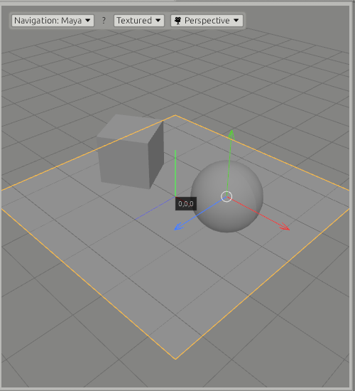

# Interface

## Top bar

A fixed line across the top of the window, for things that belong to the whole
program. It is not a pane: it cannot be moved, floated or closed. From the left:
the logo and the program's name, dimmed, with a thin divider after them: nothing
there is clickable. Then the menus, File, Edit and Window: flat titles that
light up in the accent colour under the mouse and stay lit while the menu is
open. In the middle, the name of the graph's file, in plain text, with a dot
before it while it has unsaved changes (hover it for the path). At the right,
the layout padlock, a button that lights up under the mouse too.

The menus, from the left, as in other programs:

| Menu | Holds |
|---|---|
| File | New (Ctrl+N), Open... (Ctrl+O), Open Recent, Save (Ctrl+S), Save As... (Ctrl+Shift+S), Import (Graph..., FBX..., USD..., MaterialX...), Quit (Ctrl+Q), and at the bottom Templates: the ready-made graphs, by author, then by area. See [Files](#files) and [Templates](templates.md) |
| Edit | Undo, Redo, Copy, Paste, Delete, Select All, for the operators of the root scene graph |
| Window | The panes (tick to show), Dock floating panes, Reset layout, Layout (xms_main_layout, xms_2split_layout, xms_4split_layout, Save current as default, Forget saved default), Save layout..., Load layout..., Theme |

On macOS the shortcuts take Cmd in place of Ctrl.

## Panes

Eleven panes: Viewer, Image Viewer, Node Graph, Curve Editor, UV Editor, Scene
Explorer, Operator Stack, History, Parameters, Primitive Inspector, Timeline.
Each one is a tab. The default layout, **xms_main_layout**, has the Viewer at
the left with the Image Viewer as a tab behind it (see
[Rendering](render.md#image-viewer)), and under it the Scene Explorer with the
Primitive Inspector behind; then the Node Graph, with the UV Editor and the
Curve Editor as tabs behind it (see [UV](uv.md), [Keys](keys.md)); then
Parameters over History, with the Operator Stack behind it (see
[Undo](undo.md)). The Timeline runs along the bottom. A layout saved before the
History pane, the Curve Editor or the Image Viewer existed does not have them:
tick them in the Window menu, or "Reset layout" for the default.

### Layouts

**Window > Layout** holds the layouts Imago comes with:

| Layout | What it is |
|---|---|
| xms_main_layout | The default, above |
| xms_2split_layout | Two columns: the Viewer (Image Viewer behind) over the Scene Explorer, beside Parameters (Primitive Inspector behind) over the Node Graph; the Timeline along the bottom. Seven panes: tick the others in the Window menu |
| xms_4split_layout | The Scene Explorer in a column at the left, the Viewer (UV Editor and Image Viewer behind) over the Primitive Inspector, the Node Graph (Curve Editor behind), then Parameters over the Operator Stack (History behind); the Timeline along the bottom |

**Save current as default** makes the layout as it is now the default, with
the tabs in front as they are. **Forget saved default** makes xms_main_layout
the default again. Choosing a layout keeps the lock as it is; while locked,
the layouts cannot be chosen.

Imago always opens in the default layout, with its tabs in front as saved: the
layout it had when it closed is not kept. **File > New** goes back to it too,
and so does **Reset layout**. Opening a graph leaves the layout as it is.

| To | Do this |
|---|---|
| Move a pane | Drag its tab by the title. Drop it on one of the five squares that appear over the pane under the cursor: the middle one stacks it as a tab, the others split that pane on that side |
| Float a pane | Drag its tab and drop it anywhere that is not one of the squares, or double-click the tab |
| Dock along a whole side of the window | Drag the tab to within a few pixels of that side. Blue bars mark the four sides while a tab is dragged, and a blue strip shows where the pane will land. This is how the timeline goes back across the bottom |
| Dock a floating pane | Drag its tab (the title inside the window, not the bar above it) onto one of the squares, or double-click the tab, or use "Dock floating panes" in the Window menu |
| Move a floating window | Drag the bar at its top |
| Close a pane | The cross on its tab, docked or floating |
| Show a closed pane | Tick it in the Window menu. It comes back as a tab of the main area |
| Resize | Drag the line between two panes, or the corner of a floating window |
| Start over | "Reset layout" in the Window menu: the default layout |
| Use another | Window > Layout: xms_main_layout, xms_2split_layout, xms_4split_layout |
| Make it the default | Window > Layout > Save current as default |
| Keep a layout | "Save layout..." in the Window menu writes it to a file. A file that exists is replaced only after Replace |
| Bring one back | "Load layout..." in the Window menu. A file that is not a layout is refused and the current layout stays |

Right-clicking a tab offers the same close and float actions.

### Lock

The padlock at the right of the top bar locks the layout. While it is locked,
tabs cannot be moved, floated or closed, and the layout items of the Window menu
are greyed out. The lines between panes still resize. Click the padlock again to
unlock.

### Saved layout

The lock is kept from one run to the next, in `layout.json` in the config
folder (`~/.config/xms` on Linux, `%APPDATA%\xms` on Windows); the layout
itself is not: Imago opens in the default layout. The layout saved as default,
with the place of its floating windows, is `default_layout.json` in the same
folder. A file that cannot be read is ignored and xms_main_layout is used.

When the Viewer pane is closed or hidden behind another tab, the 3D view is not
drawn.

## Files

The graph is saved as a JSON file, every ICE node with its graph. The top bar
shows its name, and "(unsaved)" while it differs from the file.

| To | Do this |
|---|---|
| Start an empty graph | File > New (Ctrl+N). Asks to save unsaved changes first |
| Open a graph | File > Open... (Ctrl+O) |
| Open one used lately | File > Open Recent: the last ten graphs opened or saved. Files no longer there are greyed out. "Clear the list" empties it |
| Save | File > Save or Ctrl+S (Cmd+S on macOS): to the current file, or asks where when there is none yet |
| Save to a new file | File > Save As... (Ctrl+Shift+S) |
| Add a saved graph to this one | File > Import > Graph... |
| Add a node reading a file | File > Import > FBX... or USD...: a Load FBX or Load USD node with the file set, right of the nodes there, selected |
| Add the materials of a MaterialX file | File > Import > MaterialX...: a MaterialX operator for each material of the `.mtlx` file (see [MaterialX](materialx.md#materialx-files)) |
| Close | File > Quit (Ctrl+Q), or the window's close button. Asks to save unsaved changes first |

### The file browser

Folders first, then the files the asking field takes (**All files** shows the
rest). **Collapse sequences**, on by default, lists files numbered alike as one
entry: `shot.####.exr   1-120 (120 files)`; picking it gives its first file.
With **UDIM** on too, a sequence numbered 1001 to 1999 in four digits is one
`<UDIM>` path, `body.<UDIM>.exr   1001-1012 (5 tiles)`, which picking gives as
it is: a texture of UDIM tiles (see [USD](usd.md#materials-in-the-viewer)). Both
are kept from one browse to the next.

### Variables

Paths and command lines can hold variables, put in when they are used. There are
two kinds, written differently so they are told apart at a glance:

- **`$NAME`, built in:** the same for every operator: the graph's file and
  folder, the project, the frames, the operator's name, the graph's own (File >
  Variables), then anything in the environment. `$GDIR/usd/$GNAME.usda`.
- **`{name}`, down the wires:** what the operators above publish for every
  operator below them, along the wires, in lower case: Write USD's `{usd}`,
  Render Settings' `{delegate}`, a Set Variable's `{shot}`. An operator can also
  have its own, read in its fields only: the Image Viewer's `{image}`, Write
  FBX's `{file}` and `{char}`.

| Built in | What it is |
|---|---|
| `$OPNAME` | the name of the operator whose text it is: `/set/$OPNAME` in a Load USD named `tree` is `/set/tree` |
| `$GNAME` | the graph's name: its file without `.xms` (`street_v001`) |
| `$GDIR` | the folder of the graph's file |
| `$JOB` | the project folder: as File > Variables sets it, else `JOB` from the environment, else `$GDIR` |
| `$F`, `$F4` | the frame (the playhead's; in a render's command, the frame rendered), `$F4` in four digits (`$F2` to `$F9` likewise) |
| `$FSTART`, `$FEND`, `$N` | the first and last frames, and how many (a render's own, in its command) |
| `$FPS`, `$T` | frames per second; the time in seconds |
| `$ASSETS`, … | the graph's own, from File > Variables |
| `$HOME`, … | anything set in the environment |

**Down the wires.** An operator publishes its `{name}`s on its output, and every
operator below it reads them, all the way down. The nearest wins: an operator's
own, then the one just above, then further up; of several inputs, the first
input's first, as Merge orders them. A bypassed operator publishes nothing, and
what comes in goes on. They are read from the operators' parameters, never by
cooking, so a Render Command runs and a panel lists them without cooking the
graph. An operator with no input (a shape, Load USD) has nothing above it. Every
operator's Parameters pane has a **Graph Variables** tab, beside Parameters (and
Prims Location): **From Above** lists what reaches it, each with the operator it
is from, and **Given Below** what it publishes itself. With none, the tab is
empty; its label counts what comes from above (`Graph Variables (3)`).

| Operator | Publishes for those below |
|---|---|
| Write USD | `{usd}`, the layer it writes |
| Render Commons | `{settings}`, its RenderSettings prim; `{camera}`, when one is chosen |
| Render Settings | `{renderer}` (`karma`, `arnold`, a custom name), `{delegate}` (husk's `-R`: `HdArnoldRendererPlugin` for Arnold, empty for Karma), and `{settings}` when none comes in |
| Camera | `{camera}`, its Primitive Location |
| Set Variable | its own rows: `{shot}`, `{variant}`, anything |

| Operator | Its own, in its fields only |
|---|---|
| Image Viewer's render line | `{usd}`, `{image}`, `{settings}`, `{camera}`, `{delegate}`, its own render's (an option whose value is empty is left out, flag and all), then what leaves the node viewed |
| Write FBX | `{dir}` the source folder, `{file}` the source file, `{char}` the character, `{take}` the take: they change with each clip it writes |

`${NAME}` sets a name apart from what follows (`${F4}_v2`), `$$` is a `$`, and a
name that is none of these is left as it is (`$1` for the shell, `{x}` for a
program: JSON and `find -exec {}` are untouched). A built-in is never in braces
(`{gname}` stays as typed), so the two kinds cannot be confused. Graphs and
command lines written before braces (`$USD`, `$IMAGE`, `$CAMERA`, `$NAME`) still
work. They work in:

- every path Imago reads or writes: Load USD, Write USD, the FBX operators
  (Write FBX's with its own `{file}`, `{char}`…), texture files of Material,
  MaterialX and light operators (written to USD with their variables put in,
  since renderers would read `$JOB` as it is);
- every Primitive Location (shapes, cameras, lights, Load USD's, render prims,
  the material library): `/shots/$GNAME/$OPNAME`;
- Set Attribute's names and text values, and the render operators' text: Render
  Settings' Output Image has Imago's variables put in, but not the frame's
  (`$F`, `$F4`, `$T`), which the renderer puts in for each frame it renders;
- command lines, and a Render Command's folder and environment values.

A graph never saved has an empty `$GDIR`. A path with `$F` follows the frame
when the graph next cooks, not while the playhead moves.

**Typing `$`** in a path or a command line lists the variables it can take, with
what each is now: the graph's own, the built-ins, and, once a letter is typed,
the environment's that start with it. Click one to put it in (after `${` it gets
its `}`). **Typing `{`** in an operator's field lists its own and what comes
down the wires to it, with their values, and a click puts one in with its `}`.

**File > Variables** is one table of three columns, **Variable**, **Result** and
**Description**, in two parts:

- **Graph**: the graph's own variables, saved in its file. **+ Variable** adds a
  row: its name (letters, digits and `_`, not a built-in's), its value in
  Result, which can hold variables too (`ASSETS` = `$JOB/assets`, with what it
  comes to under it), and what it is for, shown in the list on `$` too. 🗑
  removes it. `$JOB` sits here too, above **+ Variable**, though it is built in:
  its result is typed here; empty, it is `JOB` from the environment, else the
  graph's folder.
- **Built-in**: the other built-in ones, what they are now and what each is.

A graph's own come after the built-ins and before the environment. Changing one
is a step of the history, and the graph is unsaved until saved; what reads paths
cooks again. Importing a graph brings its variables that this graph has no
variable of that name for.

### Graph files

A graph is saved as an **`.xms`** file: plain JSON inside, so it can be read,
diffed and merged like any text. Open and Import take `.xms` and the `.json`
graphs saved before; Save As offers `.xms`, so a `.json` graph saved again
becomes an `.xms` beside it.

### Replacing files

As in other programs, nothing is written over a file that exists without asking:

- **Save As, Save layout:** choosing a name that is taken shows "*name* already
  exists. Replace it?" in the browser. Replace writes over it; Cancel goes back
  to choosing. Save (Ctrl+S) writes to the graph's own file without asking, as
  elsewhere.

  

- **Write FBX, Write USD:** when what the node would write is there already, a
  question lists it: Replace or Cancel (Esc). For one file, the files
  themselves; for All files of a folder, the folders that already hold FBX files
  and how many, since the names come from files not read yet.

Opening a graph is a step in the [history](undo.md): undo goes back to the graph
before it.

Adding a graph puts its nodes to the right of the ones there, selected, as one
step in the history. The graph open stays the current file. If nothing was
viewed (the graph was empty), the added graph's viewed operator is. An ICE node
keeps its graph however it comes in: from a file, a template, or copied and
pasted.

Opening a graph (Open or Open Recent) or picking a template asks first whether
to **Add** it to the graph, beside the nodes already there, or **Open as new**
in place of the graph. On an empty graph it opens straight away.

Anything that replaces the whole graph asks first when it has unsaved changes:
closing the window, and opening a graph or a template as new. The choice is
Save, Don't save, or Cancel (Esc). Save writes to the current file, or opens the
browser for a graph never saved; the file or template opens, or the program
closes, once it is written. Cancel keeps the graph as it is. With nothing
unsaved it goes ahead straight away. Adding replaces nothing, so it never asks
about saving. File > Import > Graph... adds without asking.

The list of recent files is kept in `recent.json` in the config folder.

## Node graph

| To | Do this |
|---|---|
| Add a node | Right-click or press Tab on the canvas. The node is centred on the place you clicked |
| Add a node after another | Right-click an output socket. The node you pick goes under that node, wired to the socket. If the place is taken it steps to the right |
| Draw a wire | Drag from an output socket with the left button |
| Remove a wire | Right-click it; or click it and press Delete or Backspace |
| Unplug a port | Click a port that has a wire (an input, or an output with one or more), then click the empty canvas: its wires come off. The port shows a ring and its wires the selection colour until then; Escape, or a click anywhere else, lets it go. A clicked output still draws a new wire, so clicking an input instead connects it |
| Unplug or move a wire in one motion | Drag from an input that has a wire: the wire comes off and its end follows the pointer. Let go on another input to connect it there, on the canvas to leave it unplugged. Ctrl+drag (Cmd+drag on macOS) from an output picks up all its wires: let go on another output to move them there, on the canvas to unplug them. A plain drag from an output still draws a new wire, as an output feeds any number of inputs |
| Select several nodes | Drag a box on the empty canvas: every node it touches; Shift+click adds or takes off one. Dragging one of them moves them all; Delete deletes them |
| See every node | "Frame" in the header, or F or A over the graph |
| Tidy the graph | "Tidy" in the header lays the nodes out in rows, top to bottom, each node above the first node that uses it |
| Copy nodes | Ctrl+C (Cmd+C on macOS) over the graph: the selected nodes, their parameters, the wires between them and the trees of their ICE nodes |
| Paste nodes | Ctrl+V (Cmd+V) over the graph: new nodes, under the pointer, selected. Each ICE node gets a tree of its own |

Inside an ICE graph, Ctrl+C and Ctrl+V copy and paste ICE nodes the same way
(not the Execution Ports), with the wires between them, under the pointer; ICE
nodes paste only into an ICE graph.

Copied nodes go to the system clipboard as text, and to `clipboard.json` in the
config folder. They paste in another window of the program, after it was closed
and started again, or on another computer from text sent over. When the
clipboard holds something else, Ctrl+V pastes the nodes copied last.

A new node is never left out of sight: the view moves just enough to show it.
Templates are laid out with Tidy and framed when they load.

Wires, ports and selection work the same way in every graph: the scene graph,
ICE graphs and MaterialX graphs (selecting and deleting a wire, unplugging a
port with two clicks, box select; `src/graph_ports.rs`).

### Set Variable: values for everything below

**Set Variable** (Organise in the add menu) hands on what comes in, and gives
every operator below it variables of its own: rows of a name and a value, read
as `{name}` in their fields (`/shots/{shot}/render.usda`, `husk … # {variant}`).
Names are letters, digits and `_`, read in lower case; a value can hold
variables too: `$` built-ins, the rows before it and `{name}` from above
(`{shot}_lgt`), and shows under its row what it comes to. A Set Variable further
down with the same name wins below it. Bypassed, it gives nothing.

Operators with no input (Load USD, the shapes) are above every Set Variable, so
they cannot read one: choosing what is cooked above, a shot's assets for
instance, is for context variables, which go the other way and come later.

### Pass Through: organising a big graph

**Pass Through** (Organise in the add menu) hands on what comes into its one
input, unchanged: geometry, a clip, a material. It does nothing else, so it is
free to put anywhere: a point to branch from, a named place to gather a long
wire, a step that labels a part of the graph. It is drawn narrower than an
operator, with square corners and no icon, so it reads as part of the layout
rather than as a step that changes the scene. It can be bypassed, viewed, frozen
and ghosted like any node.

### Placeholder: a node that does not exist yet

When a graph needs a node the program does not have, put a **Placeholder** in
its place: give it a name, as many inputs and outputs as the node would have,
each named, and describe what it should do in **Description of node
functionality for LLM**. Input 1 goes to output 1 unchanged, input 2 to output
2, and so on, so the rest of the graph keeps working. Save the graph and hand
the file over: the name, the sockets and the description are in it, and an AI
assistant reading it builds the node from them (see `LLM_instructions.md`).

### The add menu

Thirteen categories, each a submenu, each item a node. A node has one name, the
same in the menu, on the node and at the top of its parameters. Hover an item
for a line on what it does. A node is coloured by its category, but for the ICE
node (teal) and the Camera (mid grey, dark text), which stand apart; System
Commands are black with green text, as a 90s terminal.

The menu opens with a search line, ready to type in: what is typed finds the
nodes whose name, category or description has every word (`mat` finds Material,
MaterialX and Material Binding; `usd write` finds Write USD), ↓ and ↑ move the
highlight through what is found, and Enter adds the highlighted node (the first,
until an arrow is pressed).

A node with a graph inside, the ICE node and the MaterialX operator, always
wears a light grey band as wide as the selection's, as if selected in another
colour, and has a small arrow at its bottom right: double-click it, or select it
and press ↓, to go in. Selected, the selection's blue goes around the band.

| Category | Nodes |
|---|---|
| Create | Cube, Sphere, Grid, Camera, Test Clip |
| Placeholder | Placeholder |
| Organise | Set Variable, Pass Through, Compound Input, Compound Output (inside a [compound](compounds.md)) |
| File | Load USD, Write USD, Load FBX, Load FBX Folder, Write FBX |
| Modify | Transform, Edit Poly, Merge, ICE |
| Primitives | Pick Primitives, Prune Primitives, Set Attribute, Unpack |
| Materials | Material, MaterialX, Material Binding |
| Lights | Dome Light, Rect Light, Point Light, Sphere Light, Disk Light, Cylinder Light, Distant Light: one Light operator, set to each type |
| Render | Render Commons, Render Settings, Render Variables |
| System Commands | Render Command |
| UV | UV Unwrap, UV Transform, UV Edit |
| Animation | Rename Joints, Trim, Retime, Set Timecode, Time Warp, Blend, Loop, Mirror, Smooth, In Place, Floor, Prune Joints |
| Mocap | Split Characters, Characterize, Retarget, Reach, Human Limits, Capture, Skin, Auto T-Pose, Fix Pose, Proxy Skin, Body Collide |

Transform moves anything: a mesh, primitives (the picked ones, or each of them),
or a clip. A clip moves by its top joints, so a skinned mesh follows its
skeleton once and is not moved a second time.

Material Binding has its material inputs on its left side, numbered, and grows
taller as they are added; its scene input stays on top. A Material's output is
in the middle of its right side, so it wires straight across. Sockets carrying a
material are purple. Material Binding's second tab is called Bindings: its rows
are Primitive Locations with a material each.

Cube, Sphere and Grid each make a primitive at their **Primitive Location**,
`/cube`, `/sphere` and `/grid` unless another path is typed (see
[USD](usd.md#shapes-are-primitives)).

Merge joins any number of inputs, A, B, C… across its top: wiring the last one
adds another, so one is always free. Its **Mode** says how. Auto goes by the
first input: primitives are merged as primitives, each keeping its path, and on
a path two inputs have the later is the stronger; a plain mesh or a clip is
flattened into one mesh. Primitives and Flatten force one or the other.

Scatter Points and Copy to Points are done in an ICE graph. A graph saved with
them opens with a Placeholder in their place, wires kept.

### Data type colours

Every graph colours a port, and the wires into it, by the type of data it
carries, with the same colour for a type wherever it is: an ICE float and a
MaterialX float are the same teal-green. The colours are kept in one place
(`src/type_colours.rs`) and do not change with the theme.

| Colour | RGB | Type |
|---|---|---|
| Teal-green (Houdini VOPs' float) | 85, 210, 197 | Float (Scalar) |
| Blue | 80, 140, 230 | Integer, Boolean |
| Yellow | 235, 225, 60 | Vector (2D, 3D), position, texture coordinates |
| Dark yellow | 175, 150, 30 | Vector 4, quaternion, rotation |
| Orange | 240, 130, 60 | Colour (RGB, RGBA) |
| Purple | 140, 95, 190 | Matrix (3×3, 4×4): the materials' purple (no graph carries both) |
| Desaturated red-beige (Houdini VOPs' OpInput) | 210, 165, 125 | String, file name, token |
| Purple | 140, 95, 190 | Material, shader (the scene graph's material sockets, MaterialX's shaders and `material`) |
| Pink-magenta | 225, 120, 205 | BSDF, EDF, VDF (MaterialX closures) |
| Dark grey | 85, 85, 85 | Execute (ICE), and what is not known yet |

In ICE an array, whatever it holds, is the closures' pink-magenta (225, 120,
205; no ICE graph carries a closure): hover over its port to see what it holds
("array of 3D vectors"). A connected port is drawn a little lighter, a port
under the mouse lighter still. The node colours (by kind: ICE's data access
blue, MaterialX's textures blue and procedurals orange) are not type colours and
stay as they are.

### MaterialX graphs

A MaterialX operator holds a graph of MaterialX nodes, opened like an ICE graph:
double-click it, or select it and press ↓; ↑ or the path at the top goes back
up. It is drawn the same way, nodes coloured by kind (shaders purple, textures
blue, procedurals orange, geometry teal, maths and the rest a neutral grey, the
`surfacematerial` where the graph ends dark grey), the same whatever types a
node takes: only its ports and wires are coloured by type. Right-click or Tab
adds a node: the surface shaders, the material and the image nodes first, then
every node of the library by group, or by a search. Drag an output onto an input
to connect them; onto a node's body, to choose among the inputs that take it. A
wire clicked is selected, and Delete or Backspace takes it off; right-clicked,
it is taken off at once; a wire between types that do not join (after a node was
changed) is red. Nodes with many inputs, the surface shaders, show their
connected inputs only: the box at the right of the title shows them all. The
Parameters pane shows the selected node's inputs (see
[MaterialX](materialx.md)).

### ICE graphs

An ICE node holds a graph of its own. Double-click it, or select it and press ↓,
to open it; ↑ or the path at the top goes back up to the scene graph. Inside,
the graph is drawn after Softimage ICE: nodes coloured by kind (reading and
writing data blue, values, maths, random and arrays the cyan-green of
MaterialX's geometric nodes, what makes geometry, Scatter on Surface and the
Instancer, orange, the Execution Ports dark grey), each with its name over its
type, a row per port, ports and wires coloured by the type of data they carry.

| | |
|---|---|
| Add | Right-click or Tab on the canvas: a search line (↓ and ↑ through what is found, Enter adds), then the nodes by category, as in the scene graph |
| Wire | Drag from an output to an input |
| Delete | Delete or Backspace on the selected node, or right-click its title. The graph's input and output stay |
| Collapse | The box at the right of a node's title |
| Pan | Shift or middle mouse button, and drag |
| Zoom | Mouse wheel, towards the pointer |
| Frame | F or A |

A graph runs on each primitive coming in, in the primitive's own space, as an
ICE tree runs on an object in Softimage: every one, or those the ICE operator's
Prims Location tab lists. Ports and wires are coloured by the type they carry
(see [Data type colours](#data-type-colours): Scalar teal-green, Integer and
Boolean blue, 2D and 3D vectors yellow, 4D vectors dark yellow, Execute and what
is not known yet dark grey), as the graph's last run found them.

## Parameters

Every node's parameters are laid out the same way. The first group is the node's
type and its name. A name is one word: a space typed in it (here, or renaming
the node on the canvas with a double-click) becomes an underscore, and a node
added from the menu, a template or an older graph file has its spaces made
underscores too (`Pass_Through`, `Load_FBX`); ICE nodes are named the same way.
Then its parameters, in titled groups. In every group a row is a label,
right-aligned in a column of one width, and its value, which fills the rest:
sliders, fields and lists line up down the pane. Primitive Location fields have
a grey of their own, in the code font. With **Dark fields** on (see [Colour
editor](#colour-editor)), fields you type in (text, numbers, the X Y Z of a
transform) are dark grey with light text, in every theme, Primitive Location
fields a step lighter; buttons, drop-downs, checkboxes and sliders keep the
theme's look. Clip nodes end with a Clip group: what comes In and what goes Out.

Explanations are in tooltips, on a group's title or a row's label, so the pane
holds the parameters and the state of the node and little else.

Operators that work on primitives (Transform, Edit Poly, Prune Primitives, Set
Attribute, ICE) have two tabs under their name: **Parameters**, and **Prims
Location**, the primitives the operator works on. Its **Primitive Locations**
are a list, one path per row:

- A path takes that primitive and everything below it: `/DeLorean/wheels` takes
  every wheel. `*` stands for any run of characters in a name, `?` for one, `**`
  for any number of levels: `/set/**/lamp*`. `/` takes everything.
- Each row says how many of the primitives coming in it matches, in red when
  none: a typo shows at once. The tab's title counts the rows.
- A location's field is grey and in the code font, so it is told apart from the
  other text fields.
- **+ Add Location** adds the prims selected in the Scene Explorer, or an empty
  row. **Pick** adds a path from the primitives coming in.
- Rows of the Scene Explorer can be dragged and dropped on an operator in the
  Node Graph, on its Prims Location tab or on + Add Location: every selected row
  when the one dragged is selected, else that one. Their paths join the list,
  and the operator is selected with the tab open.
- An empty list means every primitive: the operator works as it did without one,
  on what an earlier Pick Primitives chose, or on everything. For Prune
  Primitives an empty list prunes nothing.
- The list is the operator's own: the operators after it see the primitives as
  they came in, not its list. It is saved with the graph and copied with the
  operator.
- Set Attribute's paths **name** prims instead: a path is that prim alone, a
  group, a camera or a light as well as a mesh, and each row counts the prims of
  the scene it names. `/set/*` names the children of `/set`, `/set/**` `/set`
  and everything below it (see [USD](usd.md#set-attribute)).

The same words mean the same thing everywhere: Translate, Rotate and Scale on
every transform (Transform, UV Transform, UV Edit, Fix Pose, Edit Poly's
Transform); Path for every file; In and Out for what passes through. Units are
in the value: m, cm, °, cm/s.

## Node buttons

Each node in the graph has buttons in its title. Bypass and View are always
there; Freeze and Ghost show when the pointer is over the node, or when they are
on.

| Button | Where | Does |
|---|---|---|
| Bypass | Left, a ring | Switches the node off. Its first input passes through unchanged. The ring turns orange with a bar through it and the node is greyed. A bypassed node with nothing wired to it gives nothing |
| Freeze | Right, a snowflake | Keeps the node's result as it is now. What is above it can change without it, or anything below it, cooking again: freeze a slow solve or a heavy load and work downstream. The snowflake turns blue and a blue bar runs along the bottom of the node. Click again to let it cook again. Saved with the graph; the result is not, so a graph opened with a frozen node cooks it once, then holds |
| Ghost | Right, a square | Draws the node's output in the Viewer as a grey wireframe, beside the scene, to line things up against: meshes by their edges at every copy, a clip by its bones at the playhead. The square turns pink. Saved with the graph |
| View | Right, a small circle; an eye on the viewed operator, large and saturated blue in every theme | Makes that operator's output the scene: what the Viewer draws, the Scene Explorer lists and the Primitive Inspector shows. Clicked again on an operator with several outputs (Load FBX: Clip, Geometry, Rest), it moves on to the next; its tooltip says which is viewed |

Holding the middle button down on a node shows what it is and what it puts out,
until the button is let go: its type, its flags, what is wired into each input,
for each output the primitives, points, triangles, materials and cameras, or the
clip's joints, frames and rate, and how long the node last took to cook, its own
work only. An output not cooked yet is cooked to be described. The middle button
held on the canvas still pans.

There is no Output node: the view flag says what the scene is, as Houdini's
display flag does. One operator always has it while the graph has any. The first
operator added to a graph gets it, and so does an operator added from the viewed
output of the viewed one; deleting the viewed operator gives it to what was
wired into it, else to the end of the last chain. A graph saved with an Output
node opens without it, the view on what was wired into Output (unless another
operator was viewed), and on the same output of it.

Bypass, Freeze and Ghost are saved with the graph, and each is a step of the
history.

## Name patterns

Fields that choose things by name take patterns instead of exact names:

- Comma-separated regular expressions. Case is ignored
- A pattern matches anywhere in the name, so a plain word means "contains this
  word". Use `^` and `$` to anchor
- Text that is not a valid expression is matched as plain text, and the field
  says so
- "Pick" lists the names coming into the node, with a filter box. Clicking a
  name adds or removes it. Names the pattern already matches are highlighted.
  "Use the filter as a pattern" adds what you typed in the filter
- Under the field: how many names match

Used by Prune Joints, Fix Pose and the Find field of Rename Joints.

## Looking through a camera

The 🎥 menu at the top of the Viewer, next to the display mode, lists the cameras
of the scene at the view flag. Choose one to look through it: the whole gate is
shown, what is outside it darkened, the camera's name at the top, in the middle.
Perspective goes back to the Viewer's own camera, where it was. Orbiting,
panning, zooming or framing while looking through a camera leaves it, the view
staying where it is (see [USD](usd.md#cameras)).

## Manipulators

A selected Transform or Camera node has handles in the Viewer, the same ones
Edit Poly has (see [Edit Poly](edit-poly.md)): Q selects, W moves, E rotates, R
scales, with the cursor over the Viewer. A drag on a handle writes into the
node's parameters as you drag, and is one step of the history when the button is
let go. The handle under the cursor turns yellow.

| Node | Pivot | Handles |
|---|---|---|
| Transform | Its translation: where the node turns and scales about | Move along an axis, or free in the plane of the screen from the centre; rotate on a ring; scale along an axis, or evenly from the centre. On a clip the scale is the same on every axis, whichever handle is pulled |
| Camera | The camera | Move and rotate. R does nothing: a camera has no size |

With Q the pivot shows as a small tripod and a dot, so where the handles will be
is in sight. A move leaves the rotation and scale as they were written; a
rotation leaves the translation and scale.

Clicking a primitive in the Viewer selects it, as clicking a row of the Scene
Explorer does: that row lights up, the Primitive Inspector shows the prim, the
selected primitives are outlined by their bounds in the Viewer. Ctrl+click
(Cmd+click on macOS) adds a primitive or takes it out; a click on nothing clears
the selection. A click is a press and release in place: a drag orbits, pans or
zooms as the navigation style has it. Not while an Edit Poly node is selected,
whose clicks pick components, and not on a handle.

## Framing

With the cursor over the Viewer:

| Key | Frames |
|---|---|
| F, G, Z, . | The selected node. With an Edit Poly node selected and vertices, edges or polygons selected in it, those components |
| A, H | Everything shown |

## Theme

The Theme menu in the top bar has three schemes. The choice is kept.

| Scheme | Look |
|---|---|
| Light | The original grey theme. The default |
| Dark | Neutral dark greys with strong text contrast |
| ADHD | Dark blue surfaces. Orange marks whatever is selected or active, and nothing else |

### Colour editor

"Edit colours..." in the Theme menu opens it. A scheme is six colours:

| Colour | Used for |
|---|---|
| Darkest surface | Canvases, text fields |
| Lightest surface | Nodes, buttons. Every other surface sits between the two |
| Text | Names, values |
| Dim text | Labels, hints |
| Accent | Selection, active flags, highlights |
| Outline | Node borders, window edges |
| Text weight | How heavy all text is drawn |
| Dark fields | Fields you type in, in the Parameters pane, dark grey with light text. On in the Light preset, off in Dark and ADHD |
| 1995 tabs | The Parameters pane's tabs drawn as index-card tabs, bevelled, the open one raised over the others. Off in every preset: off, they look like the panes' tabs |

Dark fields is a switch, not a colour: choosing a preset takes that preset's (on
for Light, off for Dark and ADHD), and Reset keeps it as it is. The environment
variable `DARK_FIELD_BG` overrides it for a run: `DARK_FIELD_BG=1` turns it on,
`DARK_FIELD_BG=0` off (the box is then greyed out, showing which). Unset, the
box decides. 1995 tabs is a switch too, kept by Reset and when another preset is
chosen.

Changes show at once and are saved as you edit, in `theme.json` in the config
folder. "Start from" loads a preset, "Reset" undoes the edits to the current
one. Colours that carry meaning (axes, wires, warnings) are the same in every
scheme. The Viewer's background follows the scheme: mid grey in Light, dark grey
in Dark and ADHD.

### Text

Text is drawn to look as it did before the move to eframe, on screens of
ordinary density (Full HD and below) as well as on high-density ones: glyphs are
not hinted (hinting makes small text blocky at 1x) and sit on whole pixels, and
text sizes are those of before (body text 12.5, code 12). How heavy text looks
is the scheme's **Text weight**, a slider in the colour editor (0 thinnest, 100
heaviest; 50 in Light, 80 in Dark and ADHD, set by eye against the earlier shell
on a Full HD screen). It is one setting for all text of a scheme, dark text on
light surfaces and light text on dark ones alike: node titles are dark on light
in every scheme.

### Selection and tabs

What is selected shows in one blue everywhere: rows in the Scene Explorer and
the Operator Stack, the ring around a selected node in the Node Graph and in ICE
graphs, and in Light the box dragged to select nodes or Edit Poly components.
The ring follows the zoom but stays between 3 and 6 pixels wide, so a selected
node can be told apart however far the graph is zoomed out. In Light, the tabs
behind sit darker than the panel and the tab in front is the lightest.

The tabs inside the Parameters pane (Parameters, Prims Location, Graph
Variables; Render Settings' Settings and AOVs; Render Command's Parameters and
Console) look like the panes' tabs, each as wide as its title (they do not share
the pane's width): the open one in the panel's colour and joined to the page
under it, the others behind it. **1995 tabs**, in Window > Edit colours (off by
default), draws them as index-card tabs instead: the open one raised, in front
of the others, with a bevel lit from the top left and a blue band along its top;
the others set back behind it, a little darker, lighter under the pointer.

### Menus

A menu stays open while it is used: ticking panes in Window, Invert zoom in
Navigation, typing in the filter of a Pick list. Choosing a command closes it,
and so does a click outside.

## Scene Explorer

The Scene Explorer lists the scene at the operator with the view flag as its own
tree, as usdview would: the prims of a stage in the stage's hierarchy, prims
made in Imago under the Xforms of their path, the joints of a clip. There is no
row for the operator: a Prune, a Merge or a shape put on another prim's path
shows as the scene has it. A plain mesh, which has no path (after Unpack, or a
Merge set to Flatten), is one row with the operator's name.

Clicking a row shows that prim, or that group and everything below it, in the
Primitive Inspector. Ctrl+click (Cmd+click on macOS) adds a row to the selection
or takes it out; Shift+click selects every row from the last one clicked. Rows
dragged out go together when the one dragged is selected (see
[Parameters](#parameters)). Clicking the only selected row again shows the whole
scene there again, and so does a selected prim leaving the scene (moving the
view flag, or a Prune). Selecting a row does not select an operator. For a
stage, opening and closing prims also decides what the Viewer draws as geometry
and what as boxes, and the guide, proxy and render toggles in the header choose
which purposes are drawn. See [USD](usd.md#the-scene-explorer-and-the-Viewer).
Only the rows in view are laid out, so a stage of tens of thousands of prims
scrolls as easily as a cube.

Each prim's type (`Xform`, `Mesh`, `PointInstancer`, `Material`, `Camera`…) is
shown in a column at the right of its row, before the geometry square; a name
too long for the row stops short of it. A prim with prims below it (a point
instancer, its prototypes under it) is one row, with them under it.

**Point instancers** show their count on their row (`PointInstancer · 2,000`).
Under it, an **Instances** row, closed to start with, lists them when opened,
one row each (`[12] pine`, the prototype it takes); nothing is listed until it
is opened, so a hundred thousand instances cost nothing until asked for. An
instancer's **Prototypes** row starts closed too: a prototype's hierarchy is a
whole asset, and it is seen at its instances. Clicking an instance outlines it
in the Viewer, its prototype's box where it is; clicking an instance in the
Viewer selects it the same way (`/forest/trees[12]`). The Primitive Inspector
shows its instancer, whose points are its instances.

**Right-click a row** to choose how the Viewer draws that prim and everything
below it: **Geometry**, **Bounding Box**, **Origin** (axes at its origin) or
**As the scene says** (the prim's `model:drawMode`, see [USD](usd.md)). The
choice shows before the type in the row. It is for the Viewer alone: it is not
part of the scene and is not written; to write it, use Set Attribute's
`model:drawMode`, or an ICE Instancer's Draw Mode.

## The Viewer's triangle budget

The Viewer draws at most 20 million triangles and line segments a frame, every
copy counted: curves count by the segments they are drawn with, points three
each. Past that, the heaviest prims are drawn as their bounding boxes, at every
copy, until the rest fits, and the Viewer says so at its bottom left ("1.0
billion triangles: 2 of the heaviest drawn as boxes…"). Two thousand copies of a
statue of half a million triangles would be a billion. A prim set to Geometry in
the Scene Explorer is always drawn as geometry. A point instancer's prototype is
one box per instance, around all its prims, however many there are, and the
budget boxes its prims together. Boxes are drawn in one draw for every copy of
every prim, and picked by their box, not their triangles.

## Operator Stack

One row per node, from the viewed operator down to the sources. A chain of
single inputs stays in one column however long it is. Only a node with several
inputs, such as a Merge, steps its branches in. The triangle at the left of a
row folds what is under it: it shows at branch points, on folded rows, and under
the cursor. The type of the node is at the right when there is room. A bypassed
node is struck through.

## Splash and icon

At start a splash shows for three seconds: a borderless window of its own,
always on top, in the middle of the primary screen. The main window is hidden
until the splash closes, then opens maximised on the primary screen. A click or
a key in the splash closes it early. Setting the environment variable
`XMS_NO_SPLASH` skips it.

The icon is the wireframe cube of the splash. It is the logo in the top bar and
the icon of the window, shown in the task bar on X11 and Windows. On Wayland and
macOS the desktop takes the icon from an installed application entry or bundle,
which the program does not ship. The icon of the file itself in Windows Explorer
is not set. Both images are in `assets/`.

## Primitive Inspector

The attributes of the scene at the view flag, as a spreadsheet: the row selected
in the Scene Explorer and what is below it, or the whole scene when none is. The
bar at the top says which, and at which operator. To look at the scene further
up the graph, move the view flag there.

| Tab | Rows |
|---|---|
| Point | Points: polygon vertices, curve control points and free points. Position `P`, normal `N` for polygon vertices, `widths` for free points |
| Edge | Polygon edges, then curve segments (between control points that follow each other, and the last back to the first on a periodic curve): `ptIndices`, its two points as one array, and the length |
| Face | Polygons, then curves, one row each: the number of corners (a curve's control points), `ptIndices`, every point of the face as one array, and the normal and area of a polygon or the length of a curve. A polygon's `firstCorner` is the Corner row its corners start at. A curve's root point is the first number of its `ptIndices` |
| Corner | Polygon corners, polygon after polygon (24 on a cube, not the 36 corners of the triangles it is drawn with): `ptIndex`, the point each corner belongs to (several corners share a point), `faceIndex`, the face it is a corner of, `localCornerIndex`, its place in that face (0 for the first, as Houdini's vertex `0:0, 0:1…`), and the UV when the mesh has them. The row number is the corner's own number, counted across the whole mesh as USD counts faceVarying values. Curves have none |
| Object | One row per primitive, with its Object attributes, those it inherits from a group above it (Set Attribute) among them |
| Properties | The selected prims themselves, not what is below them: a group, a camera or a light as well as a mesh, or the root prims with nothing selected. One row per property, `Name`, `Value` and `From`: `type`, `purpose`, `material:binding`, `visibility`, `active`, then what the file authors on the prim (`kind`, `instanceable`, `doubleSided`, `subdivisionScheme`, custom attributes) and what Set Attribute set on it (`primvars:` on a group too). Visibility and purpose can be inherited from a group above; the rest is the prim's own, as in USD. `From` says where the value comes from: `file`, `Imago` (made in Imago), the Set Attribute operator that set it, or `inherited: /path`. Click a row to select it; right-click it for **Go to Operator**, which selects the operator the value comes from: the Load USD that read the file, the shape that made the prim, or the Set Attribute that set the value, on the prim or on the group it is inherited from. Several prims selected: a Path column first |
| Joint | Joints of a clip: name, parent, position and rotation at the current frame |
| Bone | Bones of a clip: from one joint to another, with length |

Nodes that give geometry show the first six tabs, clip nodes the last two. A
selected prim with no geometry below it (a camera, an empty group) shows the
Properties tab alone. The inspector opens on Properties every time the program
starts.

**The geometry is listed when a geometry tab is opened.** On Properties, the
inspector reads the properties and counts the points, faces and corners from the
primitives as they are, without copying or placing any; the Edge and Object tabs
give their counts once a geometry tab has been opened. So a big stage (Moana)
costs the inspector next to nothing until you ask for its points. The attributes
a stage's primitives carry (displayColor, custom primvars) are kept in their
geometry as it loads, and made into rows when a geometry tab asks for them.

Each primitive is listed where it is drawn, one after the other, and points are
numbered across all of them, so the point numbers in the Edge and Face tabs are
rows of the Point tab. An edge's or a face's points are one value, an array as
long as it has corners, shown in one cell as `[0, 3, 2, 1]`; the column is as
wide as its widest cell, up to a limit past which longer arrays are cut off at
the cell's edge. A column one primitive does not have (a normal on a curve
point, the area of a curve) shows `-` on its rows. Curves are listed by their
control points as authored, whatever their basis, not by the lines they are
drawn as. With the Strands template, Point lists 3430 points (3030 control
points, then the spiral's 400), Edge 2427 segments, Face 604 curves.

The scroll bar at the right of the rows in view is dragged, or clicked, to move
through a long table; the mouse wheel moves it row by row. The mesh is cooked
and the table built only when the graph changes or another node is selected.
Moving the camera, or anything else in the Viewer that leaves the graph alone,
does not refresh it. Each frame draws only the rows in view.

**Timing a load.** `XMS_TIMINGS=1 cargo run --release` prints how long each step
of loading and showing a scene takes, every step over 20 ms, to the terminal:
opening the stage (openusd reading and composing its layers) and making its
boxes, translating the boxes and then the whole stage (xms-usd, with its own
breakdown: meshes, curves, attribute decoding), making its geometry on every
core, the Scene Explorer, the inspector, and the Viewer's scene (cooking the
graph, the boxes of closed prims).

## When the graph is cooked

The Viewer meshes, the scene explorer, the operator stack and the primitive
inspector are rebuilt when the content of the graph changes: a node added or
removed, a parameter edited, a wire changed, the view flag or the selection
moved. Moving nodes about, panning the graph and moving the camera do not cook
anything. Animated meshes are also rebuilt when the playhead moves.

Each operator's result is kept, as in Houdini, until the operator or something
above it changes. It is found by a key made of the operator's parameters and the
keys of what is wired into it, so:

- Selecting a node, redrawing the window, playing or scrubbing the timeline
  cooks nothing again: a skinned character is posed at the playhead, its clip is
  not made again.
- Changing a parameter cooks that operator and what is below it; what is above
  it, and other branches, are not cooked again. Changing it back finds the
  earlier result.
- Picking polygons in Edit Poly does not cook Edit Poly again: only its
  operations make its result. The mesh it works on is built once and kept while
  its input stays the same.
- A file read is read again when it is written again (its date and size are part
  of the key). Body Collide is asked again when a solve finishes or is cleared.
- ICE operators, and what comes after them, are cooked each time asked, as
  before.

Results are kept up to about 3 GB, the least recently used going first. Copies
of the graph (undo steps, Write FBX over a folder) share them.

Measured on the example take (728 frames, 342 joints) and the car (1.7 million
triangles), on 2 cores: a Body Collide node with the car upstream took 2.3 to
6.6 seconds every time it was asked for (its panel, the timeline and the Viewer
each ask on every frame); it now takes 1 to 2 ms after its first cook. Retarget
takes 25 to 45 ms for the take, Reach 250 ms; both work on every core, so on a
machine with more cores they take less. Edit Poly on the car takes 2.8 seconds
when an operation changes, once.

What an ICE graph computes is part of what the scene is: changing a value or a
wire in one cooks again; moving, panning, zooming or selecting in it does not.

The window draws a new frame when something happens (input, a change in the
graph, playback, a texture arriving), not all the time, so an idle window costs
almost nothing and a heavy Viewer does not slow the panes down while nothing
moves.

## Not done yet

- The Primitive Inspector shows curves' positions only: their widths and other
  attributes are not listed yet.
- The Edit menu acts on the root scene graph, not inside an ICE graph.
- Manipulators work on world axes only; no snapping to the grid or to points
  while dragging; a Transform node's pivot cannot be moved off its translation.
- Clicking a primitive selects it in the Scene Explorer, not the operator that
  placed it; the manipulator belongs to the selected node.
- Paste in the Edit menu pastes the nodes copied last; Ctrl+V over the canvas
  also takes nodes from the system clipboard, under the pointer.
- No question before Write FBX or Write USD overwrites a file in a batch run
  started some other way than the node's buttons (the tests, say).
