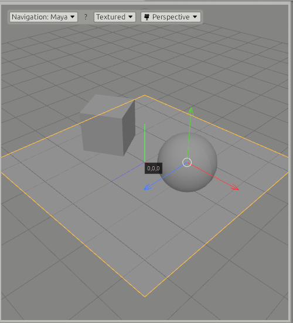
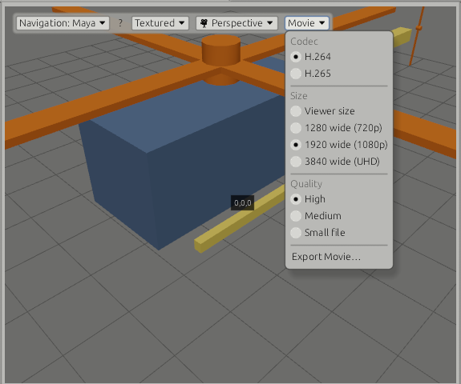
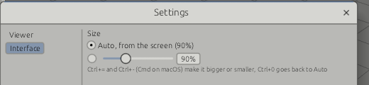
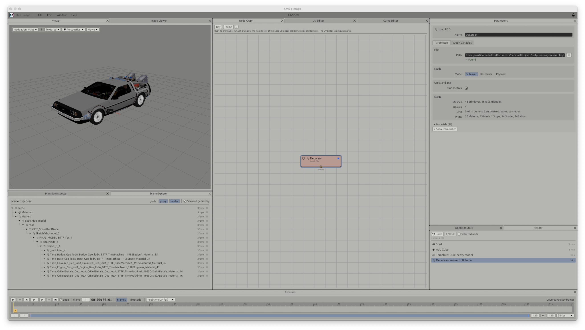
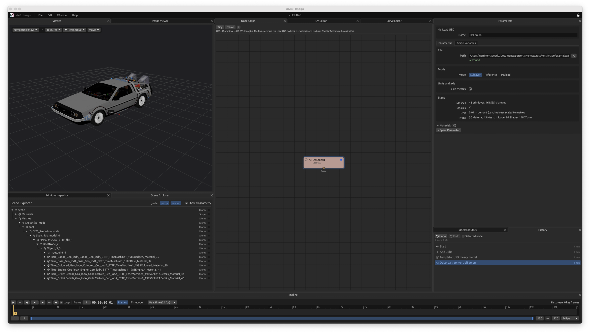

# Interface

## Top bar

The logo, the menus, the graph's file name (a dot before it while unsaved;
hover for the path) and the layout padlock.

| Menu | Holds |
|---|---|
| File | New, Open, Open Recent, Save, Save As, Variables, Settings, Import (Graph, FBX, USD, MaterialX), Quit, and the [Templates](templates.md) |
| Edit | Undo, Redo, Copy, Paste, Delete, Select All, for the root scene graph |
| Window | The panes, Dock floating panes, Reset layout, Layout, Save and Load layout, Theme |
| Help | Documentation: these pages, in your browser |

Shortcuts are Ctrl on Linux and Windows, Cmd on macOS: New N, Open O, Save S,
Save As Shift+S, Quit Q.

## Panes

Viewer, Image Viewer, Node Graph, Curve Editor, UV Editor, Scene Explorer,
Operator Stack, History, Parameters, Primitive Inspector and Timeline, each a
tab. **Window > Layout** has three layouts (xms_main_layout, the default;
xms_2split_layout; xms_4split_layout) and **Save current as default**. Imago
opens in the default layout, and File > New and Reset layout go back to it.

| To | Do this |
|---|---|
| Move a pane | Drag its tab onto one of the five squares over a pane: the middle one stacks it, the others split |
| Dock along a side of the window | Drag the tab to that edge |
| Float or dock a pane | Double-click its tab, or drop it off the squares |
| Show a closed pane | Tick it in the Window menu |
| Keep a layout | Window > Save layout... and Load layout... |

The padlock locks the layout: tabs can't be moved or closed, panes still
resize. A hidden Viewer is not drawn.

## Files

A graph is an **`.xms`** file, plain JSON, every ICE and MaterialX graph in it.
Older `.json` graphs open too.

- **Open or pick a template** over a graph with nodes asks whether to **Add**
  it beside them or **Open as new**.
- Anything that replaces the graph asks first when it has unsaved changes:
  Save, Don't save or Cancel.
- Nothing is written over an existing file without asking: Save As, Save
  layout, Write FBX and Write USD say what is there and offer Replace or
  Cancel.
- The file browser lists numbered files as one sequence (`shot.####.exr
  1-120`), and with **UDIM** on, tiles as one `<UDIM>` path. Each entry shows
  its size (a sequence's, all its files), when it last changed and its owner
  (files keep who owns them, not who changed them last). A click picks, a
  double-click opens a folder or a file; picking a folder to choose one, the
  button uses it. Rows span the window, the name from the left and the
  columns at the right edge, following it as the window is resized. It opens
  in the middle and can be moved.

### Variables

Paths and command lines can hold variables, put in when they are used:

- **`$NAME`, built in:** `$OPNAME` (the operator's name), `$GNAME` and `$GDIR`
  (the graph's file name and folder), `$JOB` (the project), `$F`, `$F4`,
  `$FSTART`, `$FEND`, `$FPS`, the graph's own from **File > Variables**, then
  the environment. `$GDIR/usd/$GNAME.usda`.
- **`{name}`, down the wires:** what the operators above publish for those below
  them: Write USD's `{usd}`, Render Settings' `{renderer}` and `{delegate}`,
  Camera's `{camera}`, a Set Variable's rows. The nearest one wins. Each
  operator's **Graph Variables** tab lists what reaches it.

Typing `$` or `{` in a field lists what it can take. `${F4}_v2` sets a name
apart; `$$` is a `$`.

## Node graph

| To | Do this |
|---|---|
| Add a node | Right-click or Tab: type to search, Enter adds |
| Add one after another | Right-click an output |
| Wire | Drag from an output to an input |
| Rewire | Drag from a wired input; Ctrl+drag an output moves all its wires |
| Remove a wire | Right-click it, or click it and Delete |
| Put a node into a wire | Drag it over the wire with Shift held (the wire lights), let go: what fed the wire feeds its first input, its first output goes where the wire went. Without Shift, nothing joins |
| Take a node out of its wires | Drag it with Shift held: past a few pixels its wires come off, and what fed its first input feeds what its first output fed, so the others stay joined. Let go over another wire, it goes in there |
| Unplug a port | Click it, then click the canvas |
| Select | Drag a box, Shift+click to add |
| Frame, tidy | F or A; Tidy in the header |
| Copy, paste | Ctrl+C, Ctrl+V, also between windows and sessions |
| Go into an ICE or MaterialX graph | Double-click it, or ↓; ↑ goes back |

Wires, ports and selection work the same in the scene, ICE and MaterialX
graphs. In a MaterialX graph, a node goes into a wire by the types its
inputs and outputs take, not only its first.

| Add menu | Nodes |
|---|---|
| Create | Cube, Sphere, Grid, Camera, Test Clip |
| Placeholder | Placeholder: a stand-in with named inputs and outputs, passing them through, and a description of the node to build |
| Organise | Set Variable, Pass Through, Compound Input, Compound Output, and making a [compound](compounds.md) |
| File | Load USD, Write USD, Load FBX, Load FBX Folder, Write FBX |
| Modify | Transform, Edit Poly, Merge, ICE |
| Primitives | Pick Primitives, Prune Primitives, Set Attribute, Edit Primitive, Reparent, Rename, Duplicate, Delete Attribute, Rename Attribute, Unpack |
| Materials | Material, MaterialX, Material Binding |
| Lights | Dome, Rect, Point, Sphere, Disk, Cylinder and Distant Light |
| Render | Render Commons, Render Settings, Render Variables |
| System Commands | Render Command |
| UV | UV Unwrap, UV Transform, UV Edit |
| Animation | Local Animation, Merge Animation, Rename Joints, Trim, Retime, Set Timecode, Time Warp, Blend, Loop, Mirror, Smooth, In Place, Floor, Prune Joints |
| Mocap | Split Characters, Characterize, Retarget, Reach, Human Limits, Capture, Skin, Auto T-Pose, Fix Pose, Proxy Skin, Body Collide |
| Rigging | Build Skeleton, Hard Bind, Envelope, Range of Motion, Delta Mush, Bake Weights, Rigid Bind, Rigid Skin, Rig Proxy |

### Data type colours

A port and its wires are coloured by the data they carry, the same in every
graph (`src/type_colours.rs`):

| Colour | Type |
|---|---|
| Teal-green | Float |
| Blue | Integer, Boolean |
| Yellow | Vector 2 and 3, position, texture coordinates |
| Dark yellow | Vector 4, quaternion |
| Orange | Colour |
| Purple | Matrix; material and shader |
| Red-beige | String, file name, token |
| Pink-magenta | MaterialX closures; ICE arrays |
| Dark grey | Execute, and not known yet |

### MaterialX graphs

Nodes coloured by kind: shaders purple, textures blue, procedurals orange,
geometry teal. Tab adds a node (the shaders first, then the library by group
or by search). Dropping a wire on a node's body lists the inputs that take it;
a wire between types that don't join is red. See [MaterialX](materialx.md).

## Parameters

The selected operator's name (one word: spaces become `_`) and its parameters,
in groups, with explanations in the tooltips.

- **A typed value takes effect on Enter** or when the field is left, as one
  undo step; Escape leaves it as it was. Dragging a number changes it live.
- **Right-click a row** to Promote it inside a compound, or Copy and Paste as
  Reference; **+ Spare Parameter** adds one of the operator's own (see
  [Compounds](compounds.md)).
- **Prims Location**, on the operators that work on primitives, lists the
  Primitive Locations they work on: a path takes
  that prim and below, `*`, `?` and `**` match names and levels, and each row
  counts its matches (red when none). An empty list means everything. Rows
  dragged from the Scene Explorer join the list.

## Node buttons

| Button | Does |
|---|---|
| Bypass (ring, left) | Passes the first input through unchanged |
| Freeze (snowflake) | Keeps the result as it is while what is above changes |
| Ghost (square) | Draws the output as a grey wireframe beside the scene |
| View (circle, an eye when on) | Makes the output the scene the Viewer, Scene Explorer and Primitive Inspector show; again, the next output |

There is no Output node: one operator always has the view flag. Holding the
middle button on a node shows its type, inputs, outputs and cook time.

## Name patterns

Fields choosing joints by name (Prune Joints, Fix Pose, Rename Joints) take
comma-separated regular expressions, case ignored, matching anywhere in the
name. **Pick** lists the names coming in; under the field, how many match.

## Viewer

- **Shading** at the top: Wireframe, Hidden Line Removal, Shaded or
  Textured. Shaded whenever Imago starts: the choice is not kept. Under them,
  **Wireframe on Shaded** draws the polygons' edges over Shaded and Textured,
  in a dark grey, and **Points** every point (of meshes and curves) as a dark
  blue dot, as Houdini's Display Points does, hidden behind what is in front
  (4 million at most). Both are off whenever Imago starts.
- **🎥** at the top lists the scene's cameras to look through; navigating
  leaves the camera where it is.
- **Click** a primitive to select it (Ctrl+click adds); **drag a box** to
  select every primitive it touches, behind others too (Ctrl adds, Shift
  takes away). Curves and points are picked by their lines, the pointer near
  one, as lights and cameras are. F frames the selection,
  A everything (F frames the prims selected, and those below them). A
  selected prim is outlined by its box (hidden behind what is in front) and
  its wireframe is drawn over it, in the Viewer's selection blue, whatever the
  shading.
- A selected Transform, Camera or Edit Primitive has handles: W move, E rotate,
  R scale, Q select. A drag is one undo step.
- Past 20 million triangles a frame, the heaviest prims are drawn as boxes,
  and the Viewer says so.

### Display Attribute

**A**, at the Viewer's top left under its bar, draws attributes over the prims,
each as its type is, as Houdini's visualizers and Gaffer's viewer show them; it
is lit while they are shown. Click it and it opens into the **Attributes** box
over the picture, the settings inside; click it again to close it. Tick **Show
attributes**, add one with **+ Attribute**, and type its name or pick it from
⏷: the attributes of the prims shown, and intrinsics (point, face and corner
numbers, face normals and areas, each face's points, `curveu`, curve lengths).

| Attribute | Drawn as |
|---|---|
| Float, boolean | The surface coloured through a ramp (Grey, or Heat: black, red, yellow, white), over the values shown unless **Min** or **Max** is ticked and typed. One value everywhere: a flat colour, and the Viewer says "all 0.5" |
| Colour (`displayColor`, Cd) | The surface in its own colour |
| 2D vector (UVs) | The surface red by u and green by v, each its place in its tile |
| 3D vector, normal | A line from each element along it, its length times **×**, coloured by the way it points |
| Integer, text, a list, anything else | A label over each element |

Where an element is drawn follows its context: a point at the point, a face at
its centre (coloured, the whole face), a corner a little towards its face's
centre, the object at its box's centre. On points and curves, colours are
coloured points. Several attributes may be listed: the first that colours a
prim colours it, lines and labels add up.

**On:** Selected (the default: the prims selected, and those below them) or
All. Colours and lines are hidden behind surfaces as the scene is. Labels are
too, behind the surfaces of the prims attributes are shown on (up to 2 million
triangles; other prims do not hide them yet), and every label in front of
them is drawn, however close to others. A label is its text alone, as in
Houdini, with a dark shadow so it reads on any surface, coloured by its
context, as XSI's are: a point's green, just right of it; a face's lilac and
a corner's amber, centred on theirs; the object's white. A list is a column
rising from its element, a value a line, six at most and how many more. Within limits, on both: a million lines, 20 million coloured
corners, and labels on screen only, nearest the camera first, at most 5,000 (made from
200,000 at most, 20,000 tested a frame). Past a limit the Viewer
says what it left out. The attributes listed are saved with the graph file;
**Show attributes** is off whenever Imago starts or a graph is opened.

### Manipulators

Transform's handles turn about its pivot (its translation plus Pivot); a camera's move and rotate;
Edit Primitive's work on the first prim it names, in its parents' space, and
override Translate, Rotate or Scale alone. World axes only, no snapping yet.

### The Viewer's triangle budget

20 million triangles and segments a frame, every copy counted. A prim set to
Geometry in the Scene Explorer is always drawn as geometry.

## Export Movie

The **Movie** menu at the top of the Viewer writes the timeline's frames, as
the Viewer shows them, to an MP4 through ffmpeg (which must be installed and on
the PATH): H.264 or H.265, the Viewer's size or 1280, 1920 or 3840 wide, three
qualities. Frames go through the camera looked through and the Viewer's View
and Display. Stop keeps the frames so far.

## Settings

**File > Settings** has a page per part of Imago:

- **Scene:** the up axis, unit and frames a second every layer Imago writes
  says, saved with the graph (Imago itself works in Y-up metres; see
  [USD](usd.md#the-scenes-axes-unit-and-rate)).
- **Viewer:** the navigation style and zoom drag (see [Viewer
  navigation](navigation.md)), and the View and Display the scene is shown in:
  the Image Viewer's (As Image Viewer, to start with) or its own (see
  [Colour](colour.md)).
- **Renderers:** each renderer as found on this machine, the **Arnold
  Folder** and **Houdini Folder** (`$ARNOLD_PATH`, `$HFS` inside Imago), where
  each definition comes from, Make editable copy, Revert to built-in, Reload
  (see [Rendering](render.md#renderer-definitions)); and **Load Shader
  Definitions from SDK**, saved with the graph (`XMS_RENDERER_SHADERS=1` for
  every graph): the renderers' own shaders in MaterialX graphs (see
  [MaterialX](materialx.md#renderers-shaders)).
- **Interface:** the size of everything but the Viewer's picture: Auto (from
  the screen's height) or 60% to 160%, also Ctrl+= and Ctrl+-, Ctrl+0 for Auto.

### Interface size

Auto is 80% on screens under 1000 points tall, 90% under 1400, 100% above, on
top of the system's own scaling.

## Theme

Window > Theme: **Light** (the default), **Dark** and **ADHD** (dark blue,
orange for what is selected). **Edit colours...** sets a scheme's six colours,
its text weight, **Dark fields** (typed fields dark in every theme) and **1995
tabs**; it is saved as you edit.

## Scene Explorer

The scene at the view flag as a tree, as usdview shows a stage; prims of several
stages under one path are one row. Click a row to show it in the Primitive
Inspector (Ctrl+click, Shift+click for more). Opening and closing rows decides
what the Viewer draws as geometry or boxes, and the guide, proxy and render
toggles which purposes. Right-click a row to draw it as Geometry, Bounding Box,
Origin or as the scene says. Enter adds an Edit Primitive on the selection. A
point instancer lists its instances only when its Instances row is opened. See
[USD](usd.md#the-scene-explorer-and-the-viewer).

## Primitive Inspector

The scene at the view flag as a spreadsheet: the selected row and below it, or
everything.

| Tab | Rows |
|---|---|
| Point, Edge, Face, Corner, Object | The geometry's attributes in that context, then its `intrinsic:` values (**Show**: All, Stored or Intrinsics). In brackets, how many attributes the context holds; how many points, faces and corners there are is in the Object tab (`intrinsic:pointCount`…). A list per element (ICE's lists stored with Set Data) is one cell, `[3, 7, 12]` |
| Properties | The selected prims themselves: type, purpose, binding, visibility, what the file authors and what operators set, with where each comes from; right-click, **Go to Operator** |
| Joint, Bone | A clip's joints and bones at the current frame |

The geometry is only read when a geometry tab is opened, so a huge stage costs
nothing until then.

## Operator Stack

One row per operator from the viewed one down to the sources; branches step in
under operators with several inputs.

## When the graph is cooked

Each operator's result is kept, as in Houdini, until the operator or something
it reads changes (its cook key: its parameters and its inputs' keys). Selecting,
redrawing and playing cook nothing again; changing a parameter cooks that
operator and what is below it. Results are kept up to about 3 GB. The window
redraws only when something happens, so an idle Imago costs nothing.

`XMS_TIMINGS=1` prints each step of a load or frame over 20 ms,
`XMS_TIMINGS=all` every step over 1 ms.

## Not done yet

- The Edit menu acts on the root scene graph, not inside an ICE graph.
- Manipulators use world axes only, with no snapping.
- Clicking a primitive selects it, not the operator that made it.
