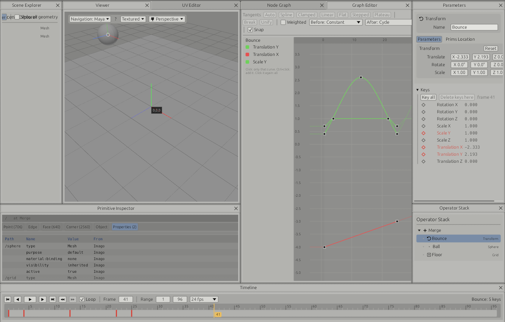
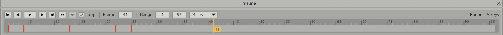
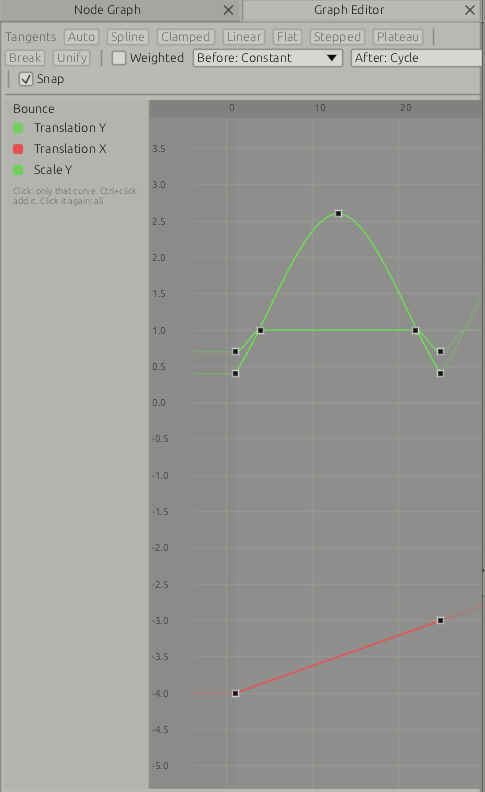

# Keys and the Graph Editor

Any number among an operator's parameters can be keyed: a Transform's translate, rotate and scale, a sphere's radius, a camera's focal length, a UV Transform's offset. The operator then cooks, at each frame, with the value its curve gives there. Moving the playhead moves the scene.

## Setting keys

| To | Do this |
|---|---|
| Key every number of the selected operator at the playhead | Tap S (anywhere but a text field), or Key all in the Keys group, or right-click the timeline |
| Key one number | Click its diamond in the Keys group, at the bottom of Parameters |
| Change a keyed number | Change it in Parameters, or drag a handle in the Viewer: it is keyed at the playhead with the new value |
| Take a key away | Click its filled diamond; Delete keys here in the Keys group or on the timeline's right-click menu; Delete in the Graph Editor |

The Keys group lists the numbers of the selected operator that can be keyed, with their values at the playhead. A diamond is filled red on a key, hollow red when the number is keyed on other frames, grey when it is not keyed. A keyed number's name is red. Rotations are shown in degrees, as Parameters shows them.

S is a tap: with the XSI navigation style, S held down with a mouse button still moves the camera and sets no key.

Changing a number that is not keyed changes it on every frame, as before. Changing a keyed number keys it there: what Parameters shows is the value at the playhead, and a change to it is never lost when the playhead moves.

A number is found by its place in the operator's parameters as they are saved (`translation/0` is translate X), so every operator can be keyed, including ones added later. Lists of rows are not keyed: Edit Poly's operations, Set Attribute's rows, Material Binding's rows. Nor are switches and text.

## The timeline

When the selected operator does not give a clip, the timeline shows the scene's range: its first and last frame and its rate, set in the timeline's header and saved with the graph (1 to 120 at 24 fps in a new graph). Keys are set on its frames.

The selected operator's keys are red ticks on the track. Drag a tick to move the keys on it to another frame. ⏪ and ⏩ go to the previous and next key. Right-click the track: key all at the playhead, or delete the keys there. When the selected operator gives a clip, the timeline follows the clip as before, and the operator's keys show on it at their time.

## The Graph Editor

A pane (Window menu, Graph Editor). In the default layout it is a tab behind the Node Graph. A layout saved before it existed does not have it: tick it in the Window menu, or Reset layout.

Frames run across, values up. The channels list at the left has the selected operator's keyed numbers, each in its colour (X red, Y green, Z blue): click one to see only its curve, Ctrl+click to add another, click it again to see them all. Before its first key and after its last, a curve is drawn fainter, as its infinity continues it. The scene's range is shaded; the playhead is the orange line.

| To | Do this |
|---|---|
| Select keys | Click a key; drag a box on the empty canvas. Shift toggles, Ctrl takes away |
| Move keys | Drag a selected key. Shift keeps to the direction first moved in (frames or values). With Snap on, frames are whole |
| Type a key's frame and value | The Frame and Value fields in the toolbar, for the selected keys (several move together) |
| Shape a tangent | Drag the handle of a selected key: its tangent becomes Fixed, both sides together unless the key is broken |
| Insert a key | Double-click a curve, or press I with the pointer over it. The key takes the curve's value there, so the curve keeps its shape |
| Delete keys | Delete or Backspace |
| Copy and paste keys | Ctrl+C, then Ctrl+V: pasted at the playhead, keeping their spacing |
| Frame | A: every curve shown. F: the selected keys |
| Pan | Middle-drag |
| Zoom | The wheel, about the pointer; Shift+wheel frames only, Ctrl+wheel values only; Alt+right-drag |
| Move the playhead | Click or drag in the ruler along the top |

### Tangents

Each side of a key has a tangent type, set for the selected keys with the toolbar's buttons:

| Type | The curve at the key |
|---|---|
| Auto | Smooth, never overshooting the keys on either side: flat at a peak, a trough or an end. New keys are Auto |
| Spline | Smooth through the keys on either side; may overshoot |
| Clamped | Spline, but flat where a neighbouring key has the same value |
| Linear | Straight to the key on that side |
| Flat | Level |
| Stepped | Holds the value until the next key |
| Plateau | Spline, flat at peaks, troughs and ends, never overshooting |
| Fixed | As dragged |

Break lets a key's two handles move apart; Unify puts them back on one slope. Weighted, for the channels of the selected keys: a handle's length then counts, and pulling one out holds the value longer near its key; not weighted, each handle is a third of the way to the next key.

### Infinity

Before and After set what a curve does past its first and last key: Constant (the end key's value), Linear (on along the end tangent), Cycle (the keys again and again), Cycle with Offset (again, each time shifted by the difference between the last key and the first: a walk keeps walking), Oscillate (forwards, then backwards).

## Saving and undo

Keys and the scene's range are saved with the graph, copied and pasted with their operators, and every change to them is a step of the history ("Bounce: keys", "Scene range 1 to 96 at 24 fps").

## Template

Animation & Mocap ▸ Keys: a bouncing ball. A sphere's Transform with translate X and Y and scale Y keyed: Y cycled with linear keys on the floor and a flat key at the top, X cycled with offset so the ball keeps moving on, scale squashing on contact.

## Not done yet

- Scaling keys in time or value about a point, Euler filter, buffer curves, normalised view.
- Keys on an operator that works on a clip (a Transform after Load FBX) take the value at the playhead for the whole clip: the clip is moved by one value, not frame by frame.
- Write USD and Write FBX write the values at the playhead, not the curves.
- The channels list shows the keyed numbers only: numbers not keyed yet are keyed from Parameters.
- Keys inside an ICE graph or a MaterialX graph.
