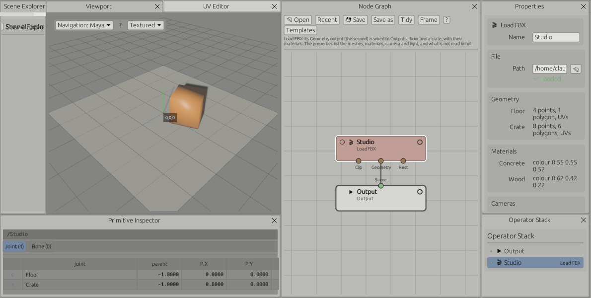
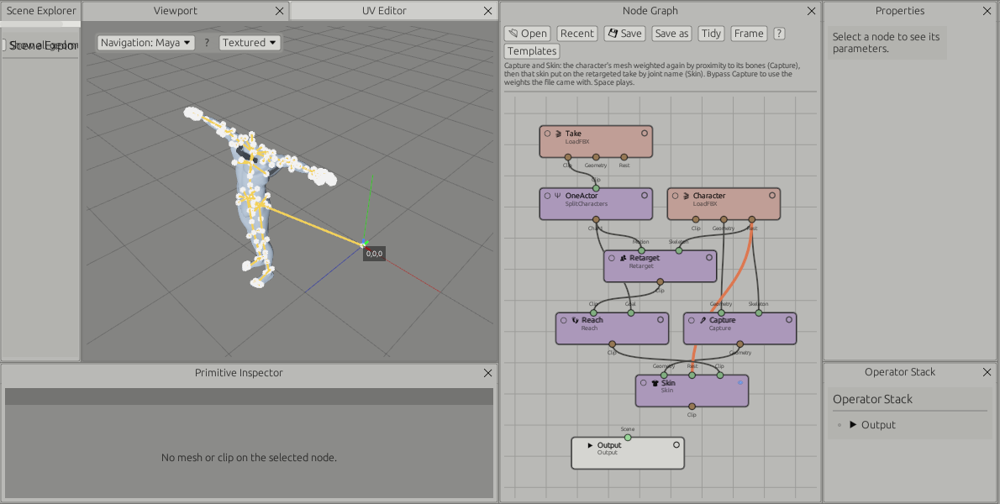
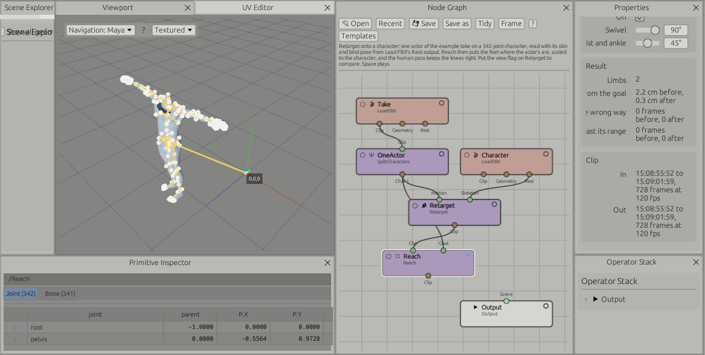

# Animation and mocap

Animation nodes are in the "Animation & Mocap" sub-menu of the add-node menu. A clip holds a skeleton, per-frame transforms, a rational frame rate and timecode, including drop-frame.

## Timeline

The timeline has no range of its own. It takes range, rate and timecode from the clip of the selected node. Space plays, Left and Right step a frame, Home and End jump to the ends.

## Nodes

| Node | What it does |
|---|---|
| Load FBX | Everything in an FBX file, converted to Y-up metres, on three outputs. **Clip**: the hierarchy and one take, baked per frame, with the mesh bound to the skeleton and its weights. **Geometry**: every mesh as a primitive, with normals, UVs, colours, material and skin weights. **Rest**: the skeleton in the pose its skin was bound in, one frame. Cameras, lights, materials, blend shapes and takes are listed in its parameters. See [Characters](#characters-fbx-skin-weights-and-retargeting) |
| Load FBX Folder | One file out of a folder, picked by index or from a dropdown of file names |
| Test Clip | A generated clip for trying things out |
| Rename Joints | Renames joints. Find is a regular expression, picked from the joint list or typed. Replace may use `$1`, `$2` for its groups |
| Trim | Cuts the clip to a range |
| Retime | Changes the frame rate |
| Set Timecode | Sets the start timecode |
| Split Characters | One output per character, by position or by root joint |
| Auto T-Pose | Rotations zeroed, root at the origin, optional hip height |
| Fix Pose | Manual rotation and position corrections. Each correction takes a joint pattern and applies to every joint it matches. An exact joint name applies to that joint only |
| Proxy Skin | A sphere per bone and a cylinder per link, bound to the skeleton |
| Write FBX | Binary FBX with skeleton and animation, and with "Mesh" ticked the mesh, skin and bind pose too. A clip from a file goes out with that file's skeleton |

## Clip tools

In the "Mocap tools" section of the same sub-menu.

| Node | What it does |
|---|---|
| Mirror | Swaps left and right joints and mirrors the motion across X |
| Smooth | Averages rotations, and optionally translations, over a radius in frames |
| In Place | Removes horizontal travel of the root. Optionally keeps the height, or moves the travel to a root joint |
| Blend | Plays the first clip, then the second, with a blend in frames. Can align the second clip to where the first ends |
| Loop | Blends the end of a clip into its start |
| Retarget | Puts the motion of the first input on the skeleton of the second. Joints are matched by the part of the body they are, so a Mixamo take drives an Unreal skeleton; joints with no part (fingers, helpers) by name, ignoring prefixes and namespaces. Each skeleton is taken in the pose its skin was bound in (its rest pose when it has no skin), so the two may rest differently. Hips travel scaled by the ratio of hip heights; where the source starts on the ground is kept as it is, so a Transform before Retarget places the result where it placed the source |
| Characterize | Says which joint is which part of a human. See below |
| Time Warp | Changes speed, or reverses |
| Prune Joints | Removes joints whose names match a pattern, with everything below them |
| Floor | Moves the clip so its lowest point sits at a height |

Retarget copies rotations and hips travel. A Transform before it carries through: the source moved or turned is retargeted moved or turned, from its first frame. Where the proportions differ the feet can slide or sink: put a **Reach** node after it (below).

## Skeletons and Characterize

Body Collide and Retarget need to know which joint is the hips, the chest, the neck, the head, and for each side the clavicle, upper arm, forearm, hand, thigh, calf, foot and toe. They read it from the joint names and the hierarchy. A **Characterize** node (Mocap menu) shows what was read and lets any part be set by hand, from a list of the joints coming in; Auto goes back to the names. What it sets travels with the clip to every node after it.

A prefix every bone shares is left out first: in a take written as `Skeleton 001_Hips`, `Skeleton 001_LeftArm` and so on, only `Hips` and `LeftArm` are read. A name is cut into words (`mixamorig:LeftForeArm` is left, fore, arm; `Bip001 L UpperArm` is l, upper, arm; `lShldrBend` is l, shldr, bend), the side and the part are read from the words, and the hierarchy decides the rest:

- The main joint of a limb is the highest one of its part above the next part: `upperarm01.L` over `upperarm02.L`, `lShldrBend` over `lShldrTwist`, `lwrist` over `lhand`.
- The hips are where the legs and the chest hang from, named as hips if one such joint is. Daz `hip` rather than `pelvis`, which only carries the legs; MakeHuman `root`.
- The chest is where both arms hang from. The spine is what lies between the hips and the chest, the neck what lies between the chest and the head, however many joints each has.
- Some conventions name joint places, not bones (SMPL, Kinect, some BVH): there the shoulder joint turns the upper arm, the hip joint the thigh, the foot joint the toes. A skeleton with elbow and wrist joints and no forearm is read that way.
- Twist joints are found by their words (twist, roll) and by where they are. In line: between two main joints, as HumanIK roll joints, Daz twist joints, MakeHuman and Rigify numbered segments. Beside: hanging off a main joint next to the limb, as Unreal and MetaHuman twist joints, Character Creator twist bones, HumanIK leaf joints, Biped twist bones.
- Correctives, helpers and controls are left out: `_correctiveRoot`, `_bck`, `_fwd`, `_in`, `_out`, `twistCor`, `ik_`, `ORG-`, `MCH-`, `J_Sec_`, `ShareBone`, end and nub joints.

Read from the names, with tests on each:

| Convention | Examples |
|---|---|
| Unreal 4, Unreal 5 and MetaHuman | `pelvis`, `spine_01` to `spine_05`, `clavicle_l`, `upperarm_l`, `lowerarm_l`, `hand_l`, `thigh_l`, `calf_l`, `foot_l`, `ball_l`, `lowerarm_twist_01_l` beside |
| Mixamo | `mixamorig:Hips`, `LeftShoulder`, `LeftArm`, `LeftForeArm`, `LeftUpLeg`, `LeftLeg`, `LeftToeBase` |
| HumanIK (Maya, MotionBuilder) | `Character1_Hips`, `LeftArmRoll` in line, `LeafLeftArmRoll1` beside |
| 3ds Max Biped | `Bip001 Pelvis`, `Bip001 L UpperArm`, `Bip001 L Forearm`, `Bip001 L Toe0`, `Bip001 LUpArmTwist` beside |
| Blender Rigify | `DEF-spine`, `DEF-upper_arm.L`, `DEF-forearm.L`, `DEF-shin.L`, head found as the end of the trunk |
| Unity humanoid, VRM | `Hips`, `UpperChest`, `LeftUpperArm`, `LeftLowerArm`, `LeftUpperLeg`, `LeftToes`; `leftUpperArm` |
| VRoid | `J_Bip_C_Hips`, `J_Bip_L_UpperArm`, `J_Bip_L_ToeBase` |
| Character Creator | `CC_Base_Hip`, `CC_Base_L_Upperarm`, `CC_Base_NeckTwist01`, `CC_Base_L_ForearmTwist01` beside |
| Daz Genesis 8 | `hip`, `lShldrBend`, `lShldrTwist` in line, `lForearmBend`, `lThighBend`, `lShin` |
| Daz Genesis 9 | `hip`, `l_upperarm`, `l_forearm`, `l_shin`, `l_toes` |
| MakeHuman | `root`, `upperarm01.L`, `upperarm02.L` in line, `wrist.L`, `upperleg01.L` |
| SMPL | `pelvis`, `left_collar`, `left_shoulder`, `left_elbow`, `left_wrist`, `left_hip`, `left_knee`, `left_ankle`, `left_foot` |
| Xsens MVN | `Pelvis`, `L5`, `T8`, `RightShoulder`, `RightUpperArm`, `RightForeArm`, `RightUpperLeg`, `RightToe` |
| OptiTrack Motive | `Hip`, `Ab`, `LShoulder`, `LUArm`, `LFArm`, `LThigh`, `LShin`, `LToe` |
| Rokoko | `hip`, `leftUpperArm`, `leftUpLeg`, `leftLeg`, `leftToe` |
| Apple ARKit | `hips_joint`, `left_shoulder_1_joint`, `left_arm_joint`, `left_upLeg_joint` |
| Source | `ValveBiped.Bip01_Pelvis`, `ValveBiped.Bip01_L_UpperArm`, `ValveBiped.Bip01_L_Toe0` |
| Bandai Namco | `Hips`, `Shoulder_L`, `UpperArm_L`, `LowerArm_L`, `UpperLeg_L`, `Toes_L` |
| Roblox R15 | `LowerTorso`, `UpperTorso`, `LeftUpperArm`, `LeftLowerLeg` |
| Azure Kinect | `PELVIS`, `CLAVICLE_LEFT`, `SHOULDER_LEFT`, `ELBOW_LEFT`, `WRIST_LEFT`, `HIP_LEFT`, `ANKLE_LEFT` |
| CMU | ASF `lhumerus`, `lradius`, `lfemur`, `ltibia`; BVH `lShldr`, `lForeArm`, `lThigh`, `lShin` and `LHipJoint`, `LeftUpLeg` |
| DeepMotion, LaFAN1 | `l_arm_JNT`, `l_upleg_JNT`; `LeftForeArm`, `LeftToe` |

Kinect v2 (`ShoulderLeft`, `ElbowLeft`) is read the same way as Azure Kinect. A skeleton whose names say nothing (`bone_12`) is set by hand: pick the hips and the main joints of each limb, and the spine, neck and twist joints follow from the hierarchy.

## Choosing joints

Joint fields take patterns, described in [Interface](interface.md#name-patterns): comma-separated regular expressions with a picker of the joints coming in. For example `thumb, index, middle, ring, pinky` or `^Left.*(Arm|Hand)$`.

## Joints and bones

With a clip node selected, the Primitive Inspector shows a Joint tab (name, parent, position and rotation at the current frame) and a Bone tab (one row per bone: the joint it starts at, the joint it points to, and its length).

## Writing FBX for an engine

A clip read from a file is written back with the skeleton it came in with, after any process: trims, retimes, mocap tools, a Body Collide solve. Same joint names and hierarchy, same kinds (an FBX "Root" stays a Root, a "LimbNode" a LimbNode), the same axes and unit as the source (Z up in centimetres for a file from Unreal), and the same local values on every joint that was not changed. An engine that imported the source as a skeleton sees the file as an animation of that skeleton.

The parameters of the Write node say which space a file goes out in, such as "Z up, cm, as the source file". A clip made in the program (Test Clip) goes out Y up in centimetres.

"Mesh" adds the skinned mesh, its skin and bind pose. Leave it off to import motion onto a skeleton the engine already has: the file then holds the skeleton and its animation only. New Write nodes start with it off; graphs saved before the switch existed keep writing the mesh.

How this is checked: the take of the Body Collide template, written as it ships and written after the shipped solve, is compared with the source FBX read without any conversion. Names, parents, kinds, axes and unit match on all 342 joints. Written straight from the FBX, the largest difference in a local rotation is 0.00003 degrees, and 0 in position (measured when the take still shipped in a packed format of its own, which stored rotations in 16 bits; it ships as FBX now). Import into Unreal itself has not been tried here.

Earlier builds wrote every file Y up, put the source's axis turn and a 0.01 scale on the top joint, and wrote the other joints a hundred times too long, so an engine saw a different skeleton. Rotations within a degree of 90 on Y could also be written half a degree out. Both are fixed.

## Batch export

Write FBX writes the current file or every file of the folder, in the background. Body Collide nodes upstream are solved first, for each file, when they have no result for it. The Templates menu has "Mocap split", which builds the whole graph for splitting a two-character take into animation files and skinned T-pose files.

Every path field has a folder button that opens the file browser. It reopens in the last folder visited.

## Graphs

The File menu (Open, Open Recent, Save, Save As, Import) reads and writes the graph as JSON. See [Interface](interface.md#files). The contents of ICE graphs are not saved.

## Not done yet

- Timeline zoom and pan, curve cleanup.
- Reach follows the source's hands and feet; it does not find contacts or lock a foot that slides in the source.
- Load FBX lists blend shapes, cameras and lights; it does not apply, draw or look through them. Several UV sets: the first is read. A mesh with several materials is shown with the first.
- Written files are checked against their source, not yet by importing them into Unreal.

## Characters: FBX, skin weights and retargeting

**Load FBX** reads everything an FBX file holds, on three outputs:

| Output | What |
|---|---|
| Clip | The skeleton and one take, baked per frame, with the mesh skinned to it. What it always gave |
| Geometry | Every mesh node as a primitive, in its own space, placed where the file has it: polygons as written, normals, UVs, vertex colours, its material (colour, roughness, metalness, opacity, colour texture) and its skin weights by joint name |
| Rest | The skeleton in the pose its skin was bound in (the file's bind pose), one frame, with the skin. Read without the take, so it is quick for a long one |

Its parameters list the meshes (points, polygons, skinned, UVs, blend shapes), the materials and their textures, the cameras (lens, film back, clipping, position, whether animated), the lights (kind, colour, intensity, position), the takes, and what is not read in full. Load FBX Mesh is gone: Load FBX's Geometry output does what it did, and graphs that used it open with a Load FBX node wired from that output.

### Skin weights by name

After Houdini's KineFX, the weights live on the geometry and go by joint name, not by joint number. The rest skeleton is a pose of its own and the animation a third thing: the same weights deform the same mesh on any animation whose joints have those names. Each point carries `skel:joint0` to `skel:joint3` (a joint name, indexed so each name is held once) and `skel:jointWeights` (four weights summing to one).

| Node | Menu | What it does |
|---|---|---|
| Capture | Mocap | Weights for every point of a mesh, by proximity to the bones of a skeleton in its first frame: the four nearest, the nearest weighing most (Falloff sets how fast). Bones above the hips weigh nothing. Inputs: geometry, skeleton |
| Skin | Mocap | Inputs: geometry with weights, the rest skeleton it was weighted in, an animation. Puts out the animation with that skin, joints matched by name (then by name without namespace), each bound where the rest skeleton has it. The panel lists names the animation does not have |

### Reach and Human Limits

The human pass of Body Collide, on its own and after a retarget. Body Collide itself is unchanged.

| Node | Menu | What it does |
|---|---|---|
| Reach | Mocap | First input a clip (a retarget), second the goal (the motion before it). The hands and feet go where the goal has them against its hips, scaled by the ratio of hip heights; each arm and leg is solved with two bones and the hand and foot keep their turn. Then the human pass. Feet on, hands off by default. The panel says how far the ends were from their goals before and after |
| Human Limits | Mocap | First input a clip that something moved (Fix Pose, a blend, a retarget), second the same clip before. Elbows and knees bend about their hinge, the way the reference bends them, never past what a human joint does; wrists and ankles stay within their range; twist joints take their share. A limit never makes a frame worse than the reference |

### A folder of raw takes, retargeted, skinned and collided

The "Mocap folder: retarget, skin, collide, write" template is the whole pipeline. Load FBX Folder reads the takes; Split Characters gives each actor; per actor, a Transform to place the actor (Place1, Place2, at zero), Retarget onto the character's Rest output (its bind pose and skin), Reach for the feet (towards the placed actor), Body Collide against the set (moved by PlaceSet), and Write FBX with Mesh ticked to `{dir}/retargeted/{file}_{char}.fbx`. **All files** on a Write FBX node solves and writes every take of the folder. The set is a stand-in (`examples/fbx/studio.fbx`): point it at your own.

On the "Retarget onto a character" template, the example take's first actor (69 joints, `Skeleton 001_…`) on the 342-joint character of `examples/ragdoll/split/into_the_car_.fbx`: Reach takes the feet from at most 2.2 cm off their goals to 0.3 cm, and no knee bends the wrong way.

## Moving a clip

Transform, the same node that moves meshes, moves a clip: Translate, Rotate and one Scale for the whole skeleton. It moves the joints at the top of the hierarchy and everything under them follows. A mesh skinned to the skeleton is not moved itself: it follows its joints when it is posed, so it moves once, with them. The skeleton's rest pose is not moved: it is the skeleton, and nodes after it (Retarget, Reach) read the move from the animation. Graphs saved with the old Transform Clip node open with a Transform node in its place, turning the clip the same way.

## Body Collide

Keeping a captured character out of a set and out of itself has a page of its own: [Body Collide](body-collide.md).
