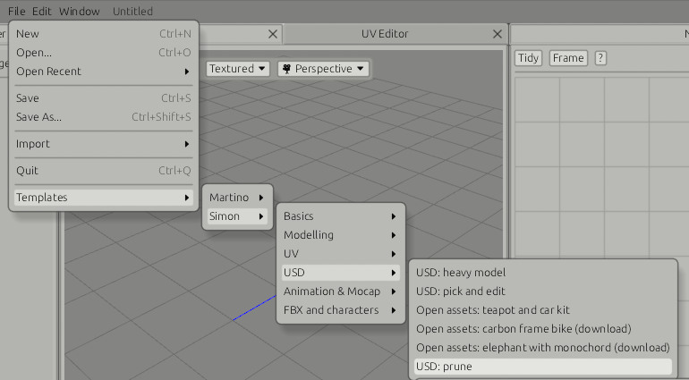
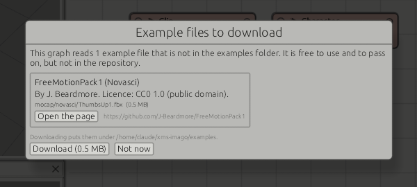

# Templates and example files

Templates are at the bottom of the File menu: ready-made graphs, by author, then
by area. Picking one asks whether to add it to the current graph, beside the
nodes already there, or open it as a new graph; opening as new asks to save
unsaved changes first (see [Interface](interface.md#files)). On an empty graph
it opens straight away. A line under the header then says what to look at.

The menu is in two parts, by whose work the templates show: **Martino**
(composed USD stages, ICE) and **Simon** (everything else).

## Martino: USD stages

Each loads one stage from `examples/stage/` with Load USD. The Scene Explorer
lists the stage; a closed prim is drawn as the box around what is below it until
it is opened, or until Show all geometry is ticked.

| Template | Shows |
|---|---|
| Composition: a street | A stage from four files: the road and pavements from a sublayer, three tables referenced from `table.usda`, the shapes on them in the variant `cafe` of the variant set `dressing`, and an override in the root layer that moves the south pavement |
| Curves and points | BasisCurves of each basis (linear, Bezier, Catmull-Rom, a periodic B-spline), 600 strands of grass, and points whose width grows along a spiral |
| Point instancer: a forest | 4,900 pines and stones from one PointInstancer, each turned and scaled, drawn by GPU instancing. A Transform after it turns the forest by moving the placements; the three shared meshes are not copied |
| Native instances: a hall of tables | 64 instanceable references to `table.usda`: five meshes read once and placed 64 times |
| Purposes: street lamps | Three lamps, each with render geometry, a proxy of blocks and a guide (its cone of light as lines). The render, proxy and guide toggles of the Scene Explorer switch them |
| Cameras | A cube, a sphere and a ground grid, and two Camera operators, Front (35 mm on a full-frame gate) and Top (orthographic, 8 m across), joined by one Merge. Choose a camera in the Viewer's 🎥 menu, or press Look through on its operator |
| Material bindings | Martino's graph: a cube, two spheres and a UV-unwrapped grid at Primitive Locations under `/root/asset`, joined by one Merge, two moved by Transforms naming them. MaterialBinding puts basePlastic, baseMetal, ground (textured with Imago's splash) and test_placeHolder under `/root/materials`, and binds the first three to the cube, the sphere and the grid by row; test_placeHolder stays unbound in the library. MaterialBinding2 binds ground to the second sphere by Location. Write USD, viewed, writes to the temporary folder |
| MaterialX: three shaders | Three spheres under `/root` with three MaterialX operators bound to them by row under `/root/materials`: Gold (a standard_surface, metal), RedPlastic (an open_pbr_surface) and Textured (an image of Imago's splash into a standard_surface's base colour; its sphere is box-unwrapped). Double-click a MaterialX node to open its graph. Write USD, viewed, writes them as MaterialX networks to the temporary folder |
| USD: material binding | The DeLorean with two Material operators, CarPaint and Chrome, wired into a Material Binding: row 1 (`/*`) binds input 1 to the whole model, row 2 (`/**/*Wheel*`) input 2 to the wheels, the later row winning. The materials go under `/materials`. Textured mode shows them; a Write USD node after it writes them |
| USD: set attribute | The DeLorean with two Set Attribute nodes: `visibility` invisible on `/**/*Wheel*`, and `kind` and a `displayColor` on `/*`, the root prim, which is a group: one opinion on it, not one per mesh. A Write USD node after them shows them written |

## Martino: ICE

| Template | Shows |
|---|---|
| ICE graph: spherify | A cube subdivided three times, then an ICE graph: Get Data reads P, Normalize sets every point to unit length, Multiply scales by 1.2, Set Data writes P back, run by the Execution Ports. Select the Spherify node and press the down arrow to go inside, the up arrow to come back |
| ICE: shrink-wrap | A subdivided cube as the scene, a sphere squashed by a Transform on Reference 1. Inside ShrinkWrap, per point: Closest Point on Surface searches the reference from each P, a Get Data with its Samples wired reads P there, Linear Interpolate blends from the cube by its T (1: on the sphere). The squash is taken into the cube's space: the cube lands where the Viewer shows the sphere |
| ICE: binding deformer | A rest grid and a copy waved by an ICE graph (Wave) on Reference 1, a cube above them as the scene. Inside Bind, per point, by hand: Closest Point on Surface on the rest grid; at that sample a frame from its triangle (`triP` and `bary`, Get Array Data with its Samples wired; tangent `p1 - p0`, normal `(p1 - p0) × (p2 - p0)`, bitangent normal × tangent; Compose Matrix); the point stored in it (its offset through the transposed frame); the same frame on the waving grid (Get Array Data with its Geometry wired too); the point put back through it. With the wave's height at 0, every point returns where it started |
| ICE: instancing | A 40 m grid as the scene, a cube and a sphere (lifted to stand on the ground) on Reference 1 and the DeLorean (Load USD as a reference, at `/protos/delorean`) on Reference 2. Inside the Instancing node, per Object: Scatter on Surface puts 240 places on the grid; Random Orientation turns each up along the normals and at random about them; Random Value, its Count the positions, scales each from 0.6 to 1.4; two Get References joined by Concatenate Arrays are the prototypes, one picked at random for each; the Instancer makes `/root/instancer`. The cars are past the Viewer's triangle budget, so they are drawn as boxes |

## XMS: Lighting & Rendering

| Template | Shows |
|---|---|
| DeLorean: lit and rendered with Karma | Martino's render scene: the DeLorean and a Camera (50 mm, 3 m up and 11.6 m back, looking 12 degrees down) merged, then a DomeLight (intensity 0.1, lit by `examples/hdri/sky.hdr` as latlong, drawn 1 m across) and a blue RectLight (exposure 5, normalized) merged in. Render Commons (1920 by 1080, no overscan, no motion blur or depth of field) and Karma's Render Settings (path traced, bucket, 32 path-traced samples, 3 per pixel, variance AA 3 to 12, diffuse limit 2, refraction limit 8; ten AOVs: C, the combined diffuse, glossy reflection and emission, glossy transmission, P, depth, N, Ng, UV), viewed; Write USD and a Render Command running husk on Karma CPU for frame 1, the layer and `render/beauty.0001.exr` in the temporary folder. husk must be on the PATH, or pick its full path in the command's presets. The Image Viewer renders the same scene |

## Simon: Basics

| Template | Shows |
|---|---|
| Shapes | Cube, sphere and grid, each moved with a Transform and joined with Merge |
| USD import | Two USD files loaded with Load USD, one moved onto the other, merged |

## Simon: Modelling

| Template | Shows |
|---|---|
| Edit Poly: tower | Inset, extrude and bevel stacked on the top face of a cube, all live |
| Edit Poly: panels | By-polygon inset and extrude on every cell of a grid, a bevel on every other one |
| Edit Poly: goblet | Edge loops with Connect, a Transform, extrudes and Subdivide. The first three operations are collapsed |
| Edit Poly: bridge | Two cubes joined with Bridge. The selection is a box rule, so it follows changes upstream |
| Edit Poly: bolt | Chamfer, slice, hinge and the other newer operations on one cube |
| Edit Poly: sea mine | Eleven operations on one cube, with one round of subdivision at the start and two at the end: about 9,600 polygons. The hull is collapsed, the horns and ports are live |

## Simon: UV

| Template | Shows |
|---|---|
| Unwrap the sea mine | UV Unwrap on the sea mine, shown in the UV Editor |
| UDIM tiles | A body and two hands made of separate pieces, unwrapped over three tiles |
| Edit UV islands | A box unwrapped, the layout scaled with UV Transform, two islands moved with UV Edit |

## Simon: USD

| Template | Shows |
|---|---|
| USD: heavy model | A 461,595 triangle model as 43 primitives, with its materials, textures and UVs |
| USD: pick and edit | One wheel picked by a path pattern, moved, and handed to an Edit Poly node. The other primitives pass through |
| USD: prune | The model cut down to its wheels and callipers, listed in the Prune node's Prims Location tab as `/**/*Wheel*` and `/**/*Calliper*` |
| Open assets: teapot and car kit | Two openly licensed models from the USD Working Group: the teapot (2,472 triangles) and the mini car kit (`vehicleVariants.usda`, six meshes with variants), the kit moved 1.5 m aside by a Transform and merged |
| Open assets: carbon frame bike (download) | A 331-mesh, 135,648-triangle bike with 31 materials, `CarbonFrameBike.usdz` (27 MB), fetched on first use (see [Example files fetched on demand](#example-files-fetched-on-demand)) |
| Open assets: elephant with monochord (download) | A textured elephant, three meshes with two PNG textures, fetched on first use |

## Simon: Animation & Mocap

| Template | Shows |
|---|---|
| Local Animation and Merge Animation | Rise keys a cube's Transform on frames 1 to 24, Roll a ball's on 49 to 60, each on frames of its own. AsTheyAre (Merge) shows frames 1 to 60; LinedUp (Merge Animation, First frame, viewed) plays both from frame 1. See [Keys](keys.md#local-animation) |
| Keys: a bouncing ball | A sphere's Transform with translate X and Y and scale Y keyed: Y cycled, linear on the floor and flat at the top, X cycled with offset so the ball keeps moving on, scale squashing on contact. Open the Curve Editor with Bounce selected (see [Keys](keys.md)) |
| Clip basics | Test Clip, Rename Joints, Trim, Retime and Set Timecode in a chain. Select each node to see the timeline follow |
| FBX import | The example take loaded with Load FBX and trimmed by a second at each end |
| T-pose and export | Auto T-Pose, Fix Pose lowering the arms, Proxy Skin and Write FBX |
| Mocap tools | A character of the example take through the clip tool nodes |
| Retarget | A character of the example take driving the test skeleton, which rests in another pose |
| Body Collide: obstacle course | The first 20 seconds of the car take on a course of boxes, one case each: a kerb stood on, a pole and a wall the arms swing into, a door walked through, a block stood and sat on, a ledge the leg rests on. Opens solved. See [Body Collide](body-collide.md#obstacle-course) |
| Body Collide: into the car | A captured actor walks through a car and sits in it, kept out of the seat, the floor and himself, within what a human body can do. A Characterize node shows which joint is which part. Opens solved. See [Body Collide](body-collide.md) |
| Mocap split (example takes) | The mocap split graph on the example folder: one take of two characters |
| Mocap split | The same graph with no folder set |

## Simon: FBX and characters

| Template | Shows |
|---|---|
| Load FBX: what a file holds | `examples/fbx/studio.fbx`, written by hand: a floor and a crate with their materials and UVs on the Geometry output, which is the one viewed, a camera that dollies in and a point light listed in the parameters |
| Retarget onto a character | The example take's first actor on the 342-joint character of `ragdoll/split/into_the_car_.fbx`, taken in the pose its skin was bound in (Load FBX's Rest output), then Reach: feet where the actor's are, within human limits |
| Capture and Skin | The same, with the character's mesh weighted again by proximity (Capture) and its skin put on the retargeted take by joint name (Skin). Bypass Capture to use the file's own weights |
| Mocap folder: retarget, skin, collide, write | The example takes folder, each actor placed by a Transform and retargeted onto the character, feet set by Reach, kept out of a stand-in set by Body Collide, written as skinned FBX to `{dir}/retargeted`. All files on a Write node solves and writes the whole folder |
| Human Limits | Fix Pose bends the test walk's left elbow 80 degrees the wrong way; Human Limits, against the walk before it, bends it back |
| Novasci clip onto the character | A Mixamo-skeleton clip from the Novasci Free Motion Pack (`mocap/novasci/ComeHere1.fbx`, 66 joints, 30 fps) retargeted onto the 342-joint character |
| Novasci clip: thumbs up (download) | The same with `ThumbsUp1.fbx`, which is not in the repository: the download dialog fetches it on first use |

## Example files

In the `examples` folder:

| File | Content |
|---|---|
| `takes/S3_12point5_002.fbx` | A real motion capture take: two characters ("Skeleton 001" and "Skeleton 002"), 136 bones, 728 frames at 120 fps |
| `DeLorean.usdz` | A production-size model: 43 mesh prims, 461,595 triangles, 30 materials, 40 textures. By VTX (https://sketchfab.com/VTX_car), CC BY-NC-SA 4.0: no commercial use. See `examples/CREDITS.md` |
| `shapes.usda` | Three meshes: pyramid, prism, octahedron |
| `table.usda` | A table: a top and four legs, five meshes |
| `stage/street.usda`, `stage/street_base.usda` | A street: the base as a sublayer, references to `table.usda` and `shapes.usda`, a variant set, an override |
| `stage/strands.usda` | BasisCurves of each basis, grass strands, a Points prim with widths |
| `stage/forest.usda` | A PointInstancer of 4,900 copies of two prototypes |
| `stage/tables.usda` | 64 instanceable references to `table.usda` |
| `stage/lamps.usda` | Three lamps with render, proxy and guide purposes |
| `hdri/sky.hdr` | A sky for dome lights, 256 by 128, latlong: blue zenith, warm horizon, a sun 35 degrees up. Made by `hdri/make_sky.py` |
| `mocap/novasci/*.fbx` | Four clips of the Novasci Free Motion Pack on the Mixamo skeleton (66 joints, 30 fps): ComeHere1, HandsOnHead, Celebrate1, GoAwayAngry. CC0. See `examples/mocap/novasci/README.md` |
| `usd/teapot/Teapot.usd` | The USD Working Group's teapot, 2,472 triangles, with its texture. See `examples/usd/teapot/README_source.md` |
| `usd/mini_car_kit/` | The USD Working Group's mini car kit: vehicles assembled from parts with variant sets. See `examples/usd/mini_car_kit/README_source.md` |

The FBX file holds skeletons and animation only, no meshes.

Every example file in the repository is under a licence that allows it to be
passed on; `examples/CREDITS.md` names each one's author and licence.

### Example files fetched on demand

Some files a template or a saved graph names are not in the repository: too big,
or under a licence that asks for a credit beside the file. When such a graph
opens, a dialog says which files are missing, who made them, under which
licence, how big they are and where they come from, and offers to download them
into the examples folder, to open the page for a download by hand, or Not now
(Esc). The download runs in the background with a progress bar; the loaders see
the new file by its date, so the graph cooks with it at once. A file declined is
not asked about again until another graph is opened.

| File | Source | Licence | Size |
|---|---|---|---|
| `mocap/novasci/*.fbx`, the 17 clips not in the repository | [Novasci Free Motion Pack 1](https://github.com/J-Beardmore/FreeMotionPack1) | CC0 1.0 | 0.3 to 0.6 MB each |
| `usd/carbon_frame_bike/CarbonFrameBike.usdz` | [USD Working Group assets](https://github.com/usd-wg/assets) | CC BY-SA 4.0 | 27 MB |
| `usd/elephant/SoC-ElephantWithMonochord.usdc` and two textures | [USD Working Group assets](https://github.com/usd-wg/assets) | CC BY-SA 4.0 | 2 MB |

The table is `SOURCES` in `src/examples.rs`: a file's path under the examples
folder, its URL and its size in bytes, so the dialog can say how much it will
fetch.

### The templates as a regression suite

Every template is also a test. `cargo test --release regression` builds each
one, cooks it at its view flag and compares what comes out (primitives, copies,
points, triangles, materials, cameras; for a clip its frames, joints, rate, skin
and where the hips end; which files were missing) with the baseline in
`tests/regression/templates.json`. A number that moves fails the test and names
the template, the field and both values. When the change is intended,
`XMS_REGRESS_UPDATE=1 cargo test --release regression` writes the baseline
again; commit it. The GitHub workflow `.github/workflows/tests.yml` runs the
suite after every build and writes the report (failed tests, the differences,
the slowest cooks, build warnings) in the job summary.

The program looks for the folder in this order: the folder named by the
`XMS_EXAMPLES` environment variable, next to the program, the root of the source
tree when run with `cargo run`, the working folder. If it is not found, the
template still loads and its message says so.

The USD files are generated by the program. To make them again:

    cargo test write_example_files -- --ignored
